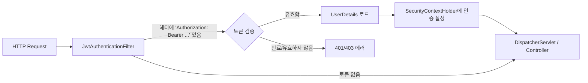

# 인증 아키텍처 및 흐름 (Authentication Architecture & Flow)

## 1. Riot OAuth 통합 호환성 검토

현재 구현된 인증 구조가 향후 Riot OAuth2 통합을 지원할 수 있는지 검토하였습니다. 현재 구조는 모듈화되어 있고 안정적이지만, Riot 로그인이 도입될 때 다음과 같은 스키마 조정이 필요합니다.

### 향후 스키마 조정 필요 사항 (`member` 테이블)
- **`password`**: 현재 `NOT NULL`입니다.
    - **변경 필요**: **`NULL`** (nullable)로 변경해야 합니다. Riot OAuth로 로그인하는 사용자는 비밀번호가 없기 때문입니다.
- **`username`**: 현재 `NOT NULL`입니다.
    - **변경 필요**: 만약 별도의 ID 생성 없이 "Riot 계정만으로" 로그인을 허용하려면 이 필드도 nullable로 변경하거나, OAuth 최초 로그인 시 별도 입력 혹은 자동 생성이 필요합니다.
    - **결론**: 사용자명을 필수로 입력받거나 자동 생성한다면 `NOT NULL` 유지가 가능합니다.

### 로직 확장성
- **`MemberService`**: 현재 비밀번호 기반 로그인을 처리합니다.
    - **확장 계획**: `oauthLogin(String puuid, ...)` 메서드를 추가하여 쉽게 확장 가능합니다. 이 메서드는 비밀번호 확인 과정을 생략하고, 기존 `login` 메서드와 동일하게 JWT(Access + Refresh)를 발급하면 됩니다.
- **JWT Subject**: 현재 `username`을 사용 중입니다.
    - **확장 계획**: 만약 사용자명이 없는 유저를 허용하게 된다면, JWT의 subject를 `Member.id` (Primary Key)로 변경하는 것을 고려해야 합니다.

> **결론**: 현재 아키텍처는 향후 확장에 구조적인 걸림돌이 없습니다. Riot OAuth 도입 시에는 DB 제약 조건을 완화하고 서비스 계층에 로그인 메서드를 추가하는 정도의 작업만 필요합니다.

---

## 2. 현재 인증 흐름 (Current Authentication Flow)

### 개요
이 시스템은 **Spring Security**와 **JWT (JSON Web Token)**를 사용합니다.
- **Access Token**: 짧은 수명(예: 30분), Stateless, JSON Body로 전달.
- **Refresh Token**: 긴 수명(예: 7일), Stateful (Redis 관리), **HttpOnly Cookie**로 전달.

### A. 회원가입 프로세스 (`POST /api/v1/members/signup`)
1.  **클라이언트**: `username`, `password`, `gameName`, `tagLine`을 전송합니다.
2.  **서비스**:
    -   `username` 중복 여부를 확인합니다.
    -   `BCryptPasswordEncoder`를 사용하여 비밀번호를 암호화합니다.
    -   DB에 `Member` 정보를 저장합니다.
    -   **자동 로그인**: 회원가입 직후 JWT 토큰을 자동으로 생성합니다.
        -   **Access Token** 생성 (HS512 서명).
        -   **Refresh Token** 생성.
        -   **Redis**에 `RefreshToken` 저장 (Key: `RT:{username}`, TTL: 7일).
3.  **컨트롤러**:
    -   `RefreshToken`을 **HttpOnly, Secure, SameSite=Strict 쿠키**에 설정합니다.
    -   `AccessToken`을 JSON 응답 Body에 담아 반환합니다.
    -   ✅ **별도의 로그인 API 호출 불필요**: 회원가입 즉시 인증된 상태로 서비스 이용 가능합니다.

### B. 로그인 프로세스 (`POST /api/v1/members/login`)
1.  **클라이언트**: `username`, `password`를 전송합니다.
2.  **서비스**:
    -   `AuthenticationManager`가 `CustomUserDetailsService`를 통해 사용자 정보를 로드합니다.
    -   입력된 비밀번호와 해시된 비밀번호가 일치하는지 검증합니다.
    -   **성공 시**:
        -   **Access Token** 생성 (HS512 서명).
        -   **Refresh Token** 생성.
        -   **Redis**에 `RefreshToken` 저장 (Key: `RT:{username}`, TTL: 7일).
3.  **컨트롤러**:
    -   `RefreshToken`을 **HttpOnly, Secure, SameSite=Strict 쿠키**에 설정합니다.
    -   `AccessToken`을 JSON 응답 Body에 담아 반환합니다.

### C. 토큰 재발급 프로세스 (`POST /api/v1/members/reissue`)
1.  **클라이언트**: 재발급 요청 (브라우저가 `RefreshToken` 쿠키를 자동으로 전송).
2.  **컨트롤러**: 쿠키에서 `refreshToken`을 추출합니다.
3.  **서비스**:
    -   JWT 서명 및 만료 여부를 검증합니다.
    -   토큰에서 `username`을 추출합니다.
    -   **Redis 확인**: 요청받은 토큰과 Redis에 저장된 토큰(`RT:{username}`)이 일치하는지 비교합니다.
        -   *보안*: 일치하지 않으면 토큰 탈취 가능성이 있으므로 요청을 거부합니다.
    -   **Rotation (교체)**:
        -   **새로운** Access Token 생성.
        -   **새로운** Refresh Token 생성.
        -   Redis에 새로운 Refresh Token으로 업데이트.
4.  **컨트롤러**:
    -   **새로운** Refresh Token을 쿠키에 설정.
    -   **새로운** Access Token을 Body로 반환.

### D. 요청 인증 (Filter Chain)
공개 엔드포인트를 제외한 모든 요청은 `JwtAuthenticationFilter`를 거칩니다:

1.  **헤더 확인**: `Authorization: Bearer <token>` 헤더를 확인합니다.
2.  **검증**: `JwtUtil.validateToken()`으로 서명과 만료 여부를 확인합니다.
3.  **인증 처리**: 유효하다면 `UsernamePasswordAuthenticationToken` 객체를 생성하여 `SecurityContext`에 저장합니다.
4.  **인가(Authorization)**: Spring Security가 해당 경로에 대한 접근 권한이 있는지 확인합니다.
