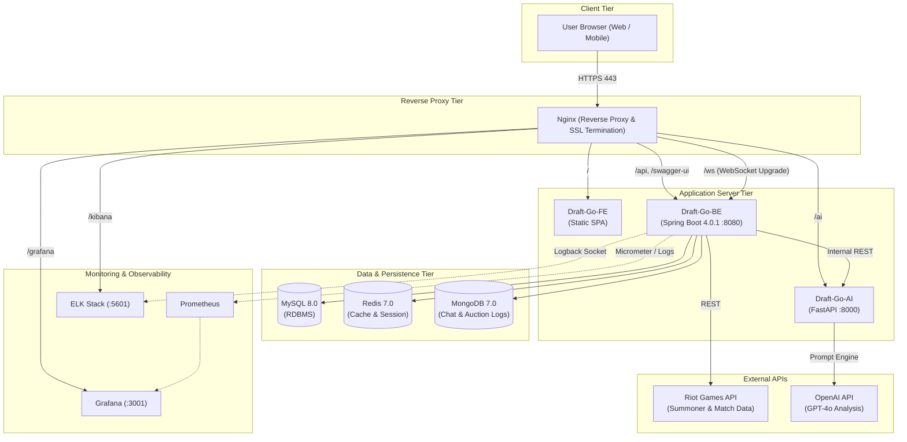
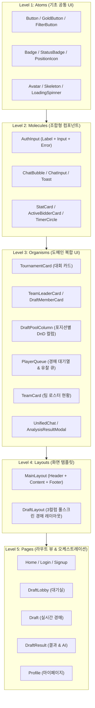
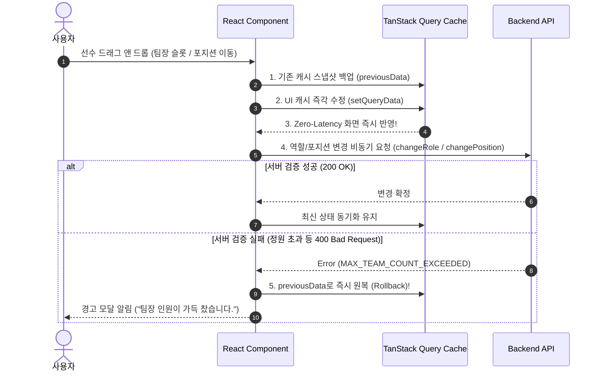
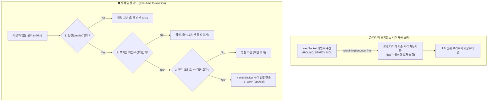
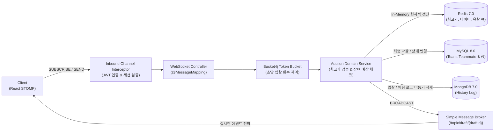
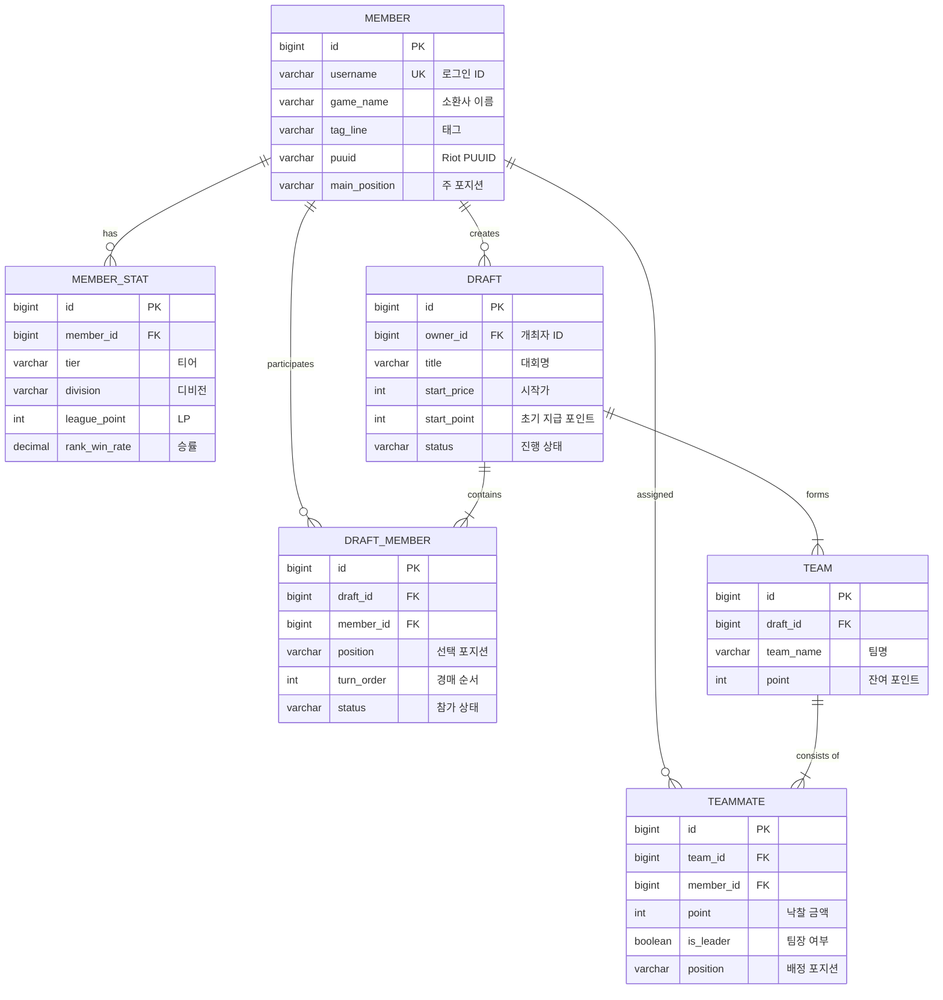

# 🎮 Draft-Go (드래프트 고)
> **League of Legends 내전 및 아마추어 대회를 위한 실시간 경매 드래프트 & AI 전력 분석 플랫폼**

<p align="center">
  
  
  
  
  
  
  
  
</p>

---

## 📌 1. 프로젝트 소개 (About)

### 💡 기획 배경 및 문제 정의 (Pain Point)
League of Legends(LoL) 사설 내전이나 대학/직장인 아마추어 리그에서 밸런스 있는 팀 빌딩을 위해 **'경매 드래프트'** 방식을 주로 채택합니다. 그러나 기존 방식은 다음과 같은 명확한 한계가 존재했습니다:
- **수기 진행의 비효율성**: 디스코드 화면 공유와 엑셀(스프레드시트) 수기 입력으로 인한 계산 실수 및 딜레이 발생
- **데이터 비동기화**: 소환사의 최근 전적이나 주 포지션 정보를 확인하기 위해 여러 전적 검색 사이트를 오가는 번거로움
- **경매 이후 분석 부재**: 팀 구성 후 즉각적인 전력 분석이나 상대팀 파훼 전략을 세우기 어려움

### 🎯 핵심 가치 (Solution)
**Draft-Go**는 이러한 문제를 해결하기 위해 탄생한 올인원 드래프트 플랫폼입니다:
1. **실시간 입찰 동시성 보장**: WebSocket과 분산 캐시를 통한 초단위 실시간 입찰 및 유찰 큐(Unsold Queue) 자동화
2. **Riot API 연동 전적 갱신**: 소환사명 기반의 실시간 랭크, 모스트 챔피언 데이터 자동 집계
3. **OpenAI(GPT-4o) 기반 전력 분석**: 완성된 팀 로스터를 기반으로 양팀의 전력, SWOT 분석, 예상 승률, 타깃 플레이어 분석 리포트 제공

---

## 🎬 2. 주요 기능 & 데모 (Features & Demo)

### 1) 마이페이지 & 실시간 소환사 전적 갱신
- Riot API를 호출하여 최신 티어, 솔로 랭크 정보, 모스트 챔피언 및 승률 데이터를 즉각 갱신
- 드래프트 참가 전 본인의 최신 전적을 프로필에 동기화

### 2) 대회 생성 및 실시간 대기실 (Lobby)
- 방장/팀장/선수 권한 관리 및 포지션 선택
- STOMP 기반 실시간 양방향 채팅 및 참가자 준비 상태(Ready) 동기화

### 3) 실시간 경매 드래프트 시스템
- **호가 입찰 & 타이머**: 제한 시간 내 실시간 입찰 경쟁 및 입찰 시 타이머 자동 갱신
- **유찰 큐 (Unsold Queue)**: 입찰자가 없어 유찰된 선수는 유찰 큐에 적재 후 본 경매 종료 시 순차 재경매
- **예산 동시성 제어**: 잔여 보유 포인트를 초과하는 무효 입찰 방지 및 실시간 포인트 차감

### 4) 결과 확인 및 팀 편성
- 경매 완료 즉시 Blue / Red 팀의 포지션별 로스터 확정
- 최종 낙찰가 및 팀별 총 지출 포인트 정산 대시보드 제공

### 5) AI 기반 팀 전력 및 승률 분석 (Powered by GPT-4o)
- **우리팀 분석**: 팀 종합 전력 평가, 핵심 플레이어(Key Player), SWOT 프레임워크 기반 강점/약점 리포트
- **상대팀 분석 & 파훼법**: 상대팀의 취약 라인(Target Player) 지정, 라인전 공략법, 예상 승률(예: 7:3) 산출

---

## 🛠 3. 기술 스택 & 시스템 아키텍처 (Tech Stack & Architecture)

### 📐 기술 스택

| 영역 | 기술 / 라이브러리 | 적용 목적 |
| :--- | :--- | :--- |
| **Frontend** | React 19, Vite, Tailwind CSS v4 | 최신 React 컴파일러 기반의 빠른 번들링과 유려한 다크 모드 UI |
| | TanStack Query v5, Zustand | 서버 상태 캐싱 최적화 및 경매/대기실 클라이언트 전역 상태 관리 |
| | SockJS, @hello-pangea/dnd | 실시간 소켓 통신 및 직관적인 선수 드래그 앤 드롭 인터페이스 |
| **Backend** | Java 17, Spring Boot 4.0.1 | 안정적인 비즈니스 로직 처리 및 확장성 있는 마이크로 구조 |
| | Spring Security, JJWT (0.11.5) | 무상태(Stateless) JWT 기반 인증/인가 처리 |
| | Spring WebSocket (STOMP) | 대기실 및 경매 세션의 저지연(Low Latency) 양방향 메시징 |
| | Bucket4j | 무분별한 입찰 트래픽 및 DoS 공격 방지를 위한 Token Bucket Rate Limiting |
| | Springdoc OpenAPI (v2.8.5) | RESTful API 명세 자동화 (Swagger UI) |
| **AI Engine** | Python 3.12, FastAPI, Uvicorn | 비동기 고성능 REST API 서빙 및 AI 추론 파이프라인 |
| | OpenAI API (GPT-4o) | 프롬프트 엔지니어링을 통한 LoL 로스터 심층 전력 분석 |
| **Data & Storage** | MySQL 8.0 (Spring Data JPA) | 유저, 팀, 대회 메타데이터의 트랜잭션 및 ACID 보장 |
| | Redis 7.0 | 경매 세션 데이터 캐싱, 실시간 최고 입찰가 동시성 제어 |
| | MongoDB 7.0 | 대규모 실시간 대기실 채팅 및 경매 로그 비정형 데이터 저장 |
| **Infra & DevOps** | Nginx, Docker & Docker Compose | Reverse Proxy(SSL 종료, 서비스 라우팅) 및 컨테이너 가상화 |
| | Jenkins (EC2) | CI/CD 파이프라인을 통한 빌드 및 무중단 자동 배포 |
| | Prometheus, Grafana, ELK | 서버 메트릭 수집, 시각화 대시보드 및 중앙 집중식 로그 분석 |

---

### 🏗 전체 인프라 & 서비스 아키텍처



---

### 🎨 프론트엔드 아키텍처 & 핵심 엔지니어링 (Frontend Engineering)

#### 1) 컴포넌트 재사용 계층 구조 (Atomic Design Hierarchy)
아토믹 디자인(Atomic Design) 및 관심사 분리(SoC) 원칙에 따라 기초 UI 토큰부터 도메인 복합체까지 5단계로 체계화했습니다:



```text
src/
├── pages/
│   ├── Home/                      # 메인 페이지 (대회 목록 탐색, 검색 필터, 대회 생성 모달)
│   ├── Profile/                   # 마이페이지 (Riot API 실시간 전적 갱신, 모스트 챔피언/승률 통계)
│   ├── DraftLobby/                # 대기실 화면
│   │   ├── sections/              # 팀장/선수 슬롯, 포지션 선택/변경 드래그, Ready 버튼
│   │   └── components/chat/       # STOMP 기반 실시간 양방향 대기실 채팅 UI
│   ├── Draft/                     # 🔥 실시간 경매 진행 화면
│   │   ├── sections/              # 상단 카운트다운 타이머, 현재 경매 대상 선수 카드
│   │   └── components/            # 실시간 호가 입찰 조작 패널, 팀별 잔여 예산 현황, 유찰 큐(Unsold Queue)
│   └── DraftResult/               # 경매 결과 & AI 전력 분석 리포트
│       └── components/result/     # Blue/Red 최종 로스터 배치도, 지출 포인트 정산표, GPT-4o 분석 카드
└── stores/                        # Zustand 전역 상태 관리
    ├── auctionStore.js            # 현재 경매 선수, 최고 입찰가, 타이머 동기화 상태
    ├── lobbyStore.js              # 대기실 참가자 목록, 슬롯 점유 및 준비 상태
    └── userStore.js               # 로그인 사용자 프로필 및 소환사 연동 정보
```

#### 2) 화면별 컴포넌트 와이어프레임 구조도 (Component Wireframes)
<details>
<summary><b>📐 주요 4대 화면 컴포넌트 단위 와이어프레임 펼쳐보기 (클릭)</b></summary>

##### ① 메인 페이지 (`Home/index.jsx`)
```text
+-----------------------------------------------------------------------------------+
|  [Header.jsx]                                                                     |
|  [Logo] LoL Auction         [대회 탐색]  [랭킹]           [Avatar] [로그인/내정보]  |
+-----------------------------------------------------------------------------------+
|  [HeroSection.jsx]                                                                |
|     "협곡의 주인을 결정하는 전략적 드래프트"                                      |
|     [GoldButton] 대회 생성하기          [Button] 코드로 참여하기                  |
+-----------------------------------------------------------------------------------+
|  [TournamentSection.jsx]                                                          |
|  [SectionTitle: 진행 중인 대회]                                                   |
|  [FilterButton: 전체 / 모집중 / 경매중 / 종료]                [SearchInput 검색]   |
|  +----------------------+  +----------------------+  +-------------------------+  |
|  | [TournamentCard.jsx] |  | [TournamentCard.jsx] |  | [TournamentCard.jsx]    |  |
|  | - StatusBadge        |  | - StatusBadge        |  | - StatusBadge           |  |
|  | - Title              |  | - Title              |  | - Title                 |  |
|  | - [Button: 입장하기] |  | - [Button: 입장하기] |  | - [Button: 입장하기]    |  |
|  +----------------------+  +----------------------+  +-------------------------+  |
+-----------------------------------------------------------------------------------+
|  [StatsSection.jsx]  [StatCard: 총 대회]  [StatCard: 소환사]  [StatCard: 낙찰 포인트]|
+-----------------------------------------------------------------------------------+
|  [Footer.jsx] Copyright © Draft-Go                                                |
+-----------------------------------------------------------------------------------+
```

##### ② 대기실 페이지 (`DraftLobby/index.jsx`)
```text
+-----------------------------------------------------------------------------------+
|  [LobbyInfoSection.jsx]  [대회명: 제1회 SSAFY 리그]  [코드: A9F12K]  [포인트: 1000pt] |
+----------------------------------------------------+------------------------------+
|  [CaptainsSection.jsx] (Drag Destination: Captain) |  [ChatSection.jsx]           |
|  +-----------------------------------------------+ |  +-------------------------+ |
|  | [TeamLeaderCard.jsx]  | [TeamLeaderCard.jsx]  | |  | [UnifiedChat.jsx]       | |
|  | - 팀장: 루안 (MID)    | - 팀장: 페이커 (MID)  | |  | - ChatBubble (System)   | |
|  | - 보유: 1000 pt       | - 보유: 1000 pt       | |  | - ChatBubble (User)     | |
|  | - [Slot 1..4 빈 슬롯] | - [Slot 1..4 빈 슬롯] | |  |                         | |
|  +-----------------------------------------------+ |  |                         | |
|                                                    |  |                         | |
|  [DraftPoolSection.jsx] (Drag Source / Droppable)  |  |                         | |
|  +-----------------------------------------------+ |  |                         | |
|  | [DraftPoolColumn: TOP / JUG / MID / BOT / SUP] | |  |                         | |
|  | +--------------------+ +--------------------+ | |  |                         | |
|  | |[DraftMemberCard]   | |[DraftMemberCard]   | | |  |                         | |
|  | | Tier: Gold 2       | | Tier: Diamond 4    | | |  |                         | |
|  | +--------------------+ +--------------------+ | |  | [ChatInput.jsx]         | |
|  | [DraftPoolColumn: SPECTATOR (관전자 풀)]       | |  | [메시지 입력...] [전송] | |
|  +-----------------------------------------------+ |  +-------------------------+ |
+----------------------------------------------------+------------------------------+
|  [LobbyFooterSection.jsx]  참가: 10/10명 완료    [포지션 변경]   [GoldButton: 게임 시작]|
+-----------------------------------------------------------------------------------+
```

##### ③ 실시간 경매 페이지 (`Draft/index.jsx`)
```text
+---------------------------------------------------------------------------------------------------------+
|  [TeamListSidebar.jsx]        |  [AuctionSection.jsx / AuctionStage.jsx]       |  [ChatSidebar.jsx]     |
|                               |                                                |                         |
|  [TeamCard: Blue Team]        |  [PlayerQueue.jsx] (선수 대기열 슬라이더)      |  [실시간 경매 로그]     |
|  - 팀장: 루안 (잔여: 620pt)   |  [Card 1] -> [Card 2] -> [Card 3] (순서대로)   |  - [입찰] Blue 220pt    |
|  - TOP: 선수 A (120pt)        |  [PassedQueueCard.jsx: 유찰 1명 대기중]        |  - [입찰] Red 240pt     |
|  - JUG: [PositionSlot (빈값)] |  --------------------------------------------  |  - [경매] 5초 남음!     |
|  - MID: 선수 B (260pt)        |  [현재 경매 대상 선수 카드]                    |                         |
|  - BOT: [PositionSlot]        |  +------------------------------------------+  |  ---------------------  |
|  - SUP: [PositionSlot]        |  | [Avatar] 소환사명: 불꽃남자               |  |  [실시간 참여자 채팅]   |
|  ---------------------------  |  | Tier: Diamond 3 / 승률: 58%              |  |  - User1: 대박 ㄷㄷ    |
|  [TeamCard: Red Team]         |  | Most: 아칼리, 사일러스, 요네              |  |  - User2: 올인 각?     |
|  - 팀장: 페이커 (잔여: 450pt) |  +------------------------------------------+  |                         |
|  - TOP: [PositionSlot]        |  [TimerCircle.jsx: 00:12] (원형 카운트다운)    |                         |
|  - JUG: 선수 C (350pt)        |  [ActiveBidderCard.jsx: 최고 입찰자 Red Team]  |                         |
|  - MID: [PositionSlot]        |  --------------------------------------------  |                         |
|  - BOT: [PositionSlot]        |  [BidButton.jsx / 입찰 패널]                   |  [ChatInput.jsx]        |
|  - SUP: [PositionSlot]        |  현재가: 240 pt  |  [GoldButton: +20pt 입찰]   |  [채팅 입력...] [전송]  |
+---------------------------------------------------------------------------------------------------------+
```

##### ④ 경매 결과 및 AI 분석 페이지 (`DraftResult/index.jsx`)
```text
+-----------------------------------------------------------------------------------+
|  [ResultHeader: 드래프트 경매 최종 결과]   소요 시간: 14분 20초 | 총 지출: 1,840 pt   |
+-----------------------------------------------------------------------------------+
|  +-------------------------------------+  +------------------------------------+  |
|  | [TeamCard.jsx (BLUE TEAM)]          |  | [TeamCard.jsx (RED TEAM)]          |  |
|  | 팀장: 루안 (잔여: 140pt)            |  | 팀장: 페이커 (잔여: 20pt)          |  |
|  | TOP: 소환사 1 (220pt)               |  | TOP: 소환사 6 (340pt)              |  |
|  | JUG: 소환사 2 (180pt)               |  | JUG: 소환사 7 (160pt)              |  |
|  | MID: 소환사 3 (310pt)               |  | MID: 소환사 8 (400pt)              |  |
|  | BOT: 소환사 4 (110pt)               |  | BOT: 소환사 9 (50pt)               |  |
|  | SUP: 소환사 5 (40pt)                |  | SUP: 소환사 10 (30pt)              |  |
|  +-------------------------------------+  +------------------------------------+  |
+-----------------------------------------------------------------------------------+
|  [Button: 우리팀 AI 분석]                    [GoldButton: 양팀 전력 비교 분석]     |
+-----------------------------------------------------------------------------------+
|  [AnalysisResultModal.jsx] (GPT-4o 전력 분석 리포트 모달)                          |
|  • 예상 승률 바: BLUE 62%  vs  RED 38%                                            |
|  • Key Player: MID (소환사 3) - 최근 10경기 승률 80%, 모스트 챔피언 지표 우세      |
|  • Target Player: BOT (소환사 9) - 상대 봇 듀오 숙련도 열세로 집중 공략 권장      |
|  • SWOT: S(상체 교전력 우세) / W(초반 바텀 안정성 부재) / O(상대 정글 갱킹률 저조) |
+-----------------------------------------------------------------------------------+
```
</details>

#### 3) 낙관적 업데이트 (Optimistic Update) & 롤백 라이프사이클
`@hello-pangea/dnd`와 TanStack Query를 결합하여 지연 없는 드래그 반응성을 보장하고 예외 시 무결성을 유지합니다:



#### 3) 실시간 타이머 시간 왜곡(Drift) 보정 & 동적 입찰 가드 (Bid Guarding)
초 단위 경매 경쟁에서 클라이언트 오차를 방지하고 무효 트래픽을 차단하는 흐름도입니다:



#### 4) 데이터 오케스트레이션 & 소켓 트래픽 격리
- **AI 분석 데이터 경량화 (`useTeamAnalysis`)**: `Promise.all`로 10인의 Riot Raw 전적을 병렬 수집한 후, 클라이언트 단에서 KDA/모스트 픽 지표로 정규화하여 AI 추론 서버의 호출 비용과 대기 시간을 대폭 단축했습니다.
- **멀티 채널 웹소켓 분리 (SoC)**: 대규모 대기실 채팅 트래픽(`useChatSocket`)과 실시간 경매 트래픽(`useDraftSocket`)을 물리적/논리적으로 분리하여 대량 채팅 시에도 입찰 렌더링에 지연이 발생하지 않도록 격리했습니다.

---

### ⚙️ 백엔드 아키텍처 & 실시간 이벤트 파이프라인 (Backend Engineering)
경매 입찰의 초단위 동시성 보장과 DoS 방지를 위한 Spring Boot + STOMP + Redis 파이프라인 구조입니다:



---

## 💻 4. 시작하기 (Getting Started)

### 📋 사전 요구사항 (Prerequisites)
- **Docker** 및 **Docker Compose**
- **Java 17** (OpenJDK 17 권장)
- **Node.js** >= 18.x & **npm**
- **Python** >= 3.12

---

### ⚙️ 환경 변수 설정

1. **Backend 환경 변수 (`Draft-Go-BE/.env`)**
   ```properties
   MYSQL_URL=jdbc:mysql://localhost:3306/draft_go_db?useSSL=false&allowPublicKeyRetrieval=true&serverTimezone=Asia/Seoul
   MYSQL_USERNAME=root
   MYSQL_PASSWORD=your_mysql_password
   
   MONGO_URI=mongodb://localhost:27017/draft-go-db
   
   REDIS_HOST=localhost
   REDIS_PORT=6379
   REDIS_PASSWORD=
   
   RIOT_API_KEY=your_riot_api_key
   RIOT_API_MODE=REAL
   
   JWT_SECRET=your_jwt_secret_key_minimum_256_bits
   JWT_ACCESS_TOKEN_VALIDITY_IN_SECONDS=1800
   JWT_REFRESH_TOKEN_VALIDITY_IN_SECONDS=604800
   ```

2. **Frontend 환경 변수 (`Draft-Go-FE/.env.development`)**
   ```properties
   VITE_API_BASE_URL=http://localhost:8080/api/v1
   VITE_WS_URL=http://localhost:8080/ws
   VITE_ENV_NAME=development
   ```

3. **AI 환경 변수 (`Draft-Go-AI/.env`)**
   ```properties
   OPENAI_API_KEY=your_openai_api_key
   AI_MODEL_NAME=gpt-4o
   ```

---

### 🚀 로컬 설치 및 실행 단계

#### 1) 인프라 서비스 실행 (MySQL, Redis, MongoDB)
```bash
cd Draft-Go-BE
docker compose up -d
```

#### 2) 백엔드 서버 기동 (Spring Boot)
```bash
cd Draft-Go-BE
./gradlew clean bootRun
# 서버 정상 기동 시: http://localhost:8080
# Swagger API 문서: http://localhost:8080/swagger-ui/index.html
```

#### 3) AI 분석 서버 기동 (FastAPI)
```bash
cd Draft-Go-AI
python -m venv venv
# Windows:
.\venv\Scripts\activate
# Mac/Linux:
source venv/bin/activate

pip install -r requirements.txt
uvicorn app.main:app --host 0.0.0.0 --port 8000 --reload
```

#### 4) 프론트엔드 개발 서버 기동 (React / Vite)
```bash
cd Draft-Go-FE
npm install
npm run dev
# 브라우저 접속: http://localhost:5173
```

---

## 🗄 5. 데이터 아키텍처 & API (Data & API)

### 📊 폴리글랏 지속성 (Polyglot Persistence) 전략
본 프로젝트는 도메인 특성에 맞추어 3가지 형태의 데이터베이스를 적재적소에 사용합니다:

1. **MySQL (RDBMS)**: 유저 계정, 대회(Tournament), 팀(Team), 선수(Player) 등 정합성과 트랜잭션이 보장되어야 하는 엔티티 모델링
2. **Redis (In-Memory K/V)**: 경매 타이머, 실시간 최고 입찰가, 사용자 세션 정보의 초고속 읽기/쓰기 및 동시성 제어
3. **MongoDB (NoSQL Document)**: 대기실 및 경매 세션 중 쏟아지는 대규모 채팅 로그와 경매 입찰 기록 히스토리 저장

#### 🗂 MySQL ERD (핵심 엔티티 관계도)


### 📑 API 명세
백엔드 구동 후 브라우저를 통해 Swagger UI 인터랙티브 문서를 확인할 수 있습니다:
- **Swagger UI**: `http://localhost:8080/swagger-ui/index.html`
- **OpenAPI JSON**: `http://localhost:8080/v3/api-docs`

---

## 📜 6. 라이선스 및 외부 서비스 안내 (License & Notices)

- **License**: 본 프로젝트는 [MIT License](LICENSE)를 따릅니다.
- **Riot Games**: Draft-Go isn’t endorsed by Riot Games and doesn’t reflect the views or opinions of Riot Games or anyone officially involved in producing or managing League of Legends. League of Legends and Riot Games are trademarks or registered trademarks of Riot Games, Inc.
- **OpenAI**: AI 팀 전력 분석 기능은 OpenAI의 GPT-4o API 모델을 기반으로 구동됩니다.
