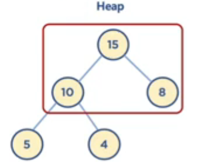

# 시간복잡도

<aside>
💡

성능이 좋은 순서대로 목차 구성

</aside>

# O(1)

---

의미 : O(1) 시간복잡도는 입력 크기 N과 상관없이 **항상 일정한 시간** 안에 실행되는 연산을 말한다.

- **힙 최대 / 최소**
    
    힙의 가장 큰 장점.
    
    최대 힙에서는 루트 노드(가장 위)에 항상 최댓값이 위치하고, 최소 힙에서는 최솟값이 위치.
    → 따라서 루트 노드에 한 번만 접근하면 되므로 시간 복잡도가 O(1)
    
- 배열의 인덱스를 통한 접근
    
    **원리:** 배열의 첫 번째 요소 주소와 인덱스를 알면, 특정 요소의 메모리 주소를 즉시 계산할 수 있다. (시작 주소 + 인덱스 * 데이터 타입 크기)
    
    **예시** : int배열 arr의 시작 주소 = 0000x00 → arr[1]의 주소 → 0000x04
    int 타입이 4byte이므로 4씩 증가하는 것.
    
- 링크드 리스트의 맨 앞 / 맨 뒤 삽입 or 삭제
    
    **원리:**  다른 노드들을 순회할 필요가 없이 head 노드와 tail 노드의 포인터를 조정하여 맨 앞이나 맨 뒤에 요소를 삽입하거나 삭제할 수 있다
    → LinkedList가 변수로 head와 tail을 저장하고 있기 때문.
    
- HashTable 삽입 / 삭제 / **탐색**
    
    해시 테이블은 해시 함수를 사용하여 키(key)를 인덱스(index)로 변환하고, 그 인덱스에 값(value)을 저장하는 자료구조입니다.
    
    - **원리:** 해시 함수가 키를 고유한 메모리 주소로 바로 변환해 주기 때문에, 원하는 데이터에 한 번의 연산으로 접근할 수 있습니다.
    - **시간 복잡도:** 평균적으로 O(1)의 시간 복잡도를 가집니다. 최악의 경우(해시 충돌이 빈번하게 발생할 때)에는 $O(N)$까지 성능이 저하될 수 있지만, 잘 설계된 해시 함수는 충돌을 최소화하여 $O(1)$의 성능을 유지합니다.
- **HashMap에서 key : value 쌍 삽입 및 조회**
    - HashMap의 put, get 연산은 평균적으로 O(1)의 시간 복잡도를 가짐
    → 해시 함수를 통해 계산된 인덱스로 곧바로 배열의 특정 버킷 을 찾아가기 때문
    - 하지만 해시 충돌 발생 시 O(logN) 또는 O(N)으로 바뀔 수 있다.
        - 하나의 버킷에 단일 엔트리만 존재하는 것이 아니라, 여러 엔트리(Entry<K,V>)가 연결 리스트로 이어지도록 변경되기 때문
        - 이 경우 원하는 키를 찾으려면 연결 리스트를 순차적으로 탐색해야 하므로, 최악의 경우 O(n) 까지 시간이 걸릴 수 있다.
            
            (예: 모든 키가 같은 해시값을 가져 하나의 버킷에 몰린 경우)
            
    - 이를 개선하기 위해 Java 8 이후에는 버킷 내 엔트리가 일정 기준(기본적으로 8개 이상) 이상 쌓이면, 연결 리스트 대신 레드–블랙 트리(Red-Black Tree) 로 전환한다.
        - 레드–블랙 트리는 균형 이진 탐색 트리이므로 검색/삽입/삭제가 O(log b) (b = 해당 버킷의 엔트리 개수, 즉 key가 겹친 엔트리의 개수) 시간에 수행된다.
        - 따라서 최악의 경우도 단순 연결 리스트 탐색인 O(n)이 아니라 O(log n) 수준으로 개선됨
    
    ```java
    import java.util.HashMap;
    
    public class Example4 {
        public static void main(String[] args) {
            HashMap<String, Integer> map = new HashMap<>();
            
            // put, get 연산은 평균적으로 O(1)
            map.put("apple", 3);    // O(1)
            map.put("banana", 5);   // O(1)
            System.out.println(map.get("apple"));    // O(1)
        }
    }
    ```
    
- Stack에서 Push / Pop / Peek
    
    Push와 Pop, Peek O(1)이라는 점은 매우 직관적으로 받아들일 수 있다.
    
    1. 포인터가 head를 가리키고 있고, head의 상단에 새 원소를 추가하든, head를 조회하든, 삭제하든 이미 알고 있는 주소와 그 값에 대한 연산밖에 발생하지 않으므로 O(1)이 된다.
    
    ```java
    import java.util.Stack;
    
    public class Example5 {
        public static void main(String[] args) {
            Stack<Integer> stack = new Stack<>();
            
            stack.push(10);   // O(1)
            stack.push(20);   // O(1)
            System.out.println(stack.pop()); // O(1)
        }
    }
    ```
    

# O(logN)

---

- **이진 탐색**
    
    조건 : 배열이 정렬되어 있는 상태여야 한다.
    
    탐색 방식
    
    1. 배열의 중간 요소 선택
    2. 찾는 값과 비교 → 일치하면 탐색 성공, 더 작으면 오른쪽 절반으로 이동, 더 크면 왼쪽 절반으로 이동
    3. 범위를 계속 줄여가며 반복
    
    탐색할 때마다 탐색 구간이 절반으로 줄어든다 → 나눌 수 있는 횟수 = log₂N
    
    - EX ) 원소 16개 배열이 있을 때:
    
    ```java
    target = 1로 최솟값인 경우 (최악 조건)
    초기 상태 : [1,2,3,4,5,6,7,8,9,10,11,12,13,14,15,16]
    
    Search 1 : [1,2,3,4,5,6,7,8,9,10,11,12,13,14,15,16]
    -> pivot = 8, target < pivot, 다음 탐색 수행
    
    Search 2 : [1,2,3,4,5,6,7,8]
    -> pivot = 4 -> target < pivot, 다음 탐색 수행
    
    Search 3 : [1,2,3,4]
    -> pivot = 2 -> target < pivot, 다음 탐색 수행
    
    Search 4 : [1,2]
    -> pivot = 1, -> target == pivot, 탐색 종료
    -----------------------------------------------------------------------------
    target = 16으로 최댓값인 경우 (최악 조건)
    초기 상태 : [1,2,3,4,5,6,7,8,9,10,11,12,13,14,15,16]
    
    Search 1 : [1,2,3,4,5,6,7,8,9,10,11,12,13,14,15,16]
    -> pivot = 8, target > pivot, 다음 탐색 수행
    
    Search 2 : [9,10,11,12,13,14,15,16]
    -> pivot = 12 -> target > pivot, 다음 탐색 수행
    
    Search 3 : [13,14,15,16]
    -> pivot = 14 -> target > pivot, 다음 탐색 수행
    
    Search 4 : [15,16]
    -> pivot = 15, -> target > pivot, 다음 탐색 수행
    
    Search 5 : [16]
    -> pivot = 16, -> target == pivot, 탐색 종료
    ```
    
    - 두 최악의 경우에서 1회의 차이 발생
        - 2로 나누는 연산을 통해 배열을 나눠 나가고, 나머지를 버리는 과정이 왼쪽에서 오른쪽으로 발생하기 때문에 오른쪽에서 1회의 탐색이 더 필요한 경우가 발생한다. ⇒ (logN + 1)
        - 하지만 빅오 표기법에서 최고차항 미만의 수는 무시하기 때문에 그대로 O(logN)으로 표기한다.
    - log의 정의에 초점을 맞춘, logN의 시간 복잡도를 갖는다는 말에 대한 이해
        
        ⇒ N개의 원소를 가진 배열을 원소가 1개만 남을 때까지 둘로 나눌 때, 몇 번 나눌 수 있는가?
        ⇒ 16개의 원소를 가진 배열을 원소가 1개만 남을 때까지 둘로 나눌 때, 몇 번 나눌 수 있는가?
        ⇒ log₂(16) == 4;
        
        - 진수가 2의 제곱수라 딱 떨어지는 예시일 뿐, 꼭 2의 제곱수가 아니더라도 나눈 값의 나머지를 버려가며 계산하면 동일하게 계산할 수 있다.
        - EX) 원소 개수가 20개인 배열에서 target = 1인 경우
            - 20 ⇒ 10 ⇒ 5 ⇒ 2(나머지 버림) ⇒ 1, 동일하게 4번의 분할을 통해 1이 등장한다
            - 당연한 이야기지만 20이라는 수가 2^4(16) 과 2^5(32) 사이의 숫자이기 때문
            - target = 20이었다면 logN+1의 식에 따라 5회의 탐색이 발생했을 것이다.
    
- **힙 / 이진 탐색 트리**
    
    
    
    
    
    
    <aside>
    💡
    
    힙 : 데이터에서 최대값과 최소값을 빠르게 찾기 위해 고안된 완전 이진 트리
    완전 이진 트리 : 노드 삽입 시 최하단 왼쪽 노드부터 차례대로 삽입하는 트리
    
    </aside>
    
    - 장점
        - 최대 or 최소 탐색의 시간 복잡도 : 배열은 O(N), 힙은 O(logN) → 빠르다!
        - 우선순위 큐와 같이 최대 또는 최소를 빠르게 찾아야 하는 자료구조나 알고리즘에 활용
    - 이진 탐색 트리와의 공통점과 차이점
        - 공통점 : 둘 다 이진 트리 구조
        - 원소 값 관점에서의 차이점
            - **힙** : 각 노드의 값이 두 자식 노드보다 크거나 같다 (Min Heap이면 작거나 같다.)
            - **이진 탐색 트리** : 나보다 작으면 왼쪽에, 나보다 크면 오른쪽에 보내기 때문에 **왼쪽 자식이 가장 작고 부모가 중간, 오른쪽 자식이 가장 크다**.
        - 탐색 관점에서의 차이점
            - **힙** : 최대 / 최소를 빠르게 찾기 위한 구조 (최대, 최소, 정렬 특화)
                - 힙은 루트 노드에 대한 접근이 O(1)이다.
                - 따라서 어떤 배열의 값을 힙 자료구조에 넣었다가 순서대로 빼면 정렬된 상태로 나오는데 이게
            - **이진 탐색 트리** : 특정 값의 탐색을 위한 구조
                - 이진 탐색 트리는 이름부터가 탐색인만큼 탐색에서 유리하다. O(logN)의 복잡도를 갖는다.
                - 대신 오른쪽과 같이 최악의 경우, O(N)의 복잡도를 갖게 된다.
                
                
                
                
                
        - 삽입 관점에서의 차이점
            - **힙** : 일단 배열에 원소를 넣은 후 재배치하는 방식, 비교가 부모 노드와만 일어나므로 왼쪽 오른쪽 자식 의 대소는 알 수 없음.
            - **이진 탐색 트리** : 배열에 원소를 넣기 전에 인덱스를 확인하면서 들어갈 자리를 찾아서 들어가는 방식
            - 힙 삽입 과정
                1. 비어 있다면 그냥 넣기
                2. 값의 크기와 상관 없이 왼쪽부터 넣기 (완전 이진 트리 구조)
                3. 부모보다 크지 않을 때까지 swap 반복
                - swap 없이 일반적으로 그냥 들어가는 케이스
                    
                    
                    
                    
                    
                    
                - swap이 발생하는 케이스
                    
                    
                    
                    
                    
                    
                
            - 이진 탐색 트리 삽입 과정
                
                
                
        - 삭제 관점에서의 차이점
            - 힙
                - 루트 노드를 삭제하는 것이 일반적 - 최대와 최소의 관점에서 활용되는 구조이기 때문
                - 루트 노드 삭제 → 마지막 노드(최하단 최우측 노드)를 루트 노드로 이동
                - 새로 루트가 된 값과 자식 노드를 비교
                    - 두 자식 노드가 다 루트보다 크다면 → 둘 중 더 큰 값을 루트로 변경
                    - 두 자식 노드 중 하나만 루트보다 크다면 → 해당 값을 루트로 변경
                    - 둘 다 루트보다 작다면 → 유지
                - 비교를 통해 루트를 스왑했다면, 그 아래에서 또 자식 노드들과의 비교
                - 이 과정을 자식 둘이 모두 나보다 작거나 리프에 도달할 때까지 반복
                
                
                
                
                
            - 이진 탐색 트리
                - 리프 노드인 경우 : 삭제할 노드의 부모 노드가 null을 가리키도록 하면 끝
                - 자식 노드를 하나만 갖고 있는 경우 : 부모 - 자식(삭제 대상) - 손자 일 때, 부모가 손자를 가리키게 하면 끝
                - 자식 노드를 두 개 갖고 있는 경우 : 이게 복잡하다. 삭제할 대상의 위치를 대체할 노드를 찾아야 함
                    - 삭제할 노드의 오른쪽 서브트리에서 가장 작은 값을 가진 노드 탐색(오른쪽 서브트리의 가장 왼쪽 아래)
                    - 후계자 노드의 값을 삭제할 노드의 값으로 복사합니다.
                    - 이제 원래 후계자 노드가 있던 위치에서 후계자 노드를 삭제합니다.
                    - 이 후계자 노드는 자식이 없거나(리프 노드) 오른쪽 자식만 있을 수 있으므로, 위의 1번 또는 2번 규칙을 재적용하여 삭제.
                    
                    ---
                    
                    Case 1 : 리프 노드 삭제
                    
                    
                    
                    Case 2 : 자식이 1개인 노드 삭제
                    
                    
                    
                    Case 3 : 자식이 2개인 노드 삭제
                    
                    
                    
                
    - 시간 복잡도
        - 힙
            - 삽입 : O(logN)
            - 삭제 : O(logN)
            - 최대 / 최소 탐색 : O(1)
        - 이진 탐색 트리
            - 일반적으로 아래와 같지만 최악의 경우 한쪽으로 치우친 트리의 모양이 되어 연결 리스트의 구조가 되어 셋 모두 N의 시간 복잡도를 갖게 된다.
            - 삽입 : O(logN)
            - 삭제 : O(logN)
            - 탐색 : O(logN)
    

# O(N)

---

- 반복문
- 배열의 삽입과 삭제
- 링크드리스트 탐색
- 중간 삽입과 삭제

직관적으로 1회의 반복문 또는 탐색을 하는 경우에 해당하고, 꼭 기억해야 할 알고리즘이나 자료 구조는 딱히 없어 보이기 때문에 패스

# O(NlogN)

---

정렬 시각화 사이트 : https://visualgo.net/en/sorting

- 병합 정렬
    
    ```java
    **public class** mergeSort {
    	// 원 배열
    	**static** **int**[] *arr* = **new** **int**[] { 5, 4, 2, 7, 3, 1, 8, 9 };
    	**static** **int** *N* = *arr*.length; // arr 길이
    	**static** **int**[] *temp* = **new** **int**[*N*]; // 정렬된 배열을 임시 저장할 임시 배열
    
    	**public** **static** **void** main(String[] args) {
    		*mergeSort*(0, *N* - 1);
    		System.***out***.println(Arrays.*toString*(*arr*));
    	}
    
    	**static** **void** mergeSort(**int** start, **int** end) {
    		// start와 end가 만나면 그 사이에 아무 원소도 없으므로
    		// 더 이상 배열을 분할하지 않는다.
    		// 만나지 않는 경우에만 배열을 분할, 정복
    		**if** (start < end) {
    			// 홀수면 자동 내림
    			**int** mid = (start + end) / 2;
    			// 왼쪽 배열
    			*mergeSort*(start, mid);
    			// 오른쪽 배열
    			*mergeSort*(mid + 1, end);
    			// 병합
    			*merge*(start, mid, end);
    		}
    	}
    
    	**static** **void** merge(**int** start, **int** mid, **int** end) {
    		// merge는 temp 배열의 start부터 end까지의 인덱스의 값들을
    		// 정렬된 상태로 합치는 과정이다.
    		// 인덱스가 될 변수들을 선언해 주기
    		**int** L = start; // 왼쪽 배열의 인덱스가 될 L
    		**int** R = mid + 1; // 오른쪽 배열의 인덱스가 될 R
    		**int** idx = start; // temp 배열의 인덱스가 될 idx
    
    		// for문이 아닌 while문임에 주의
    		**while** (L <= mid && R <= end) {
    			// 왼쪽 배열의 L번째와 오른쪽 배열의 R번째를 비교해서
    			// 더 작은 값이 temp에 들어간다.
    			// 왼쪽 배열과 오른쪽 배열이라고 말하기는 했지만
    			// 사실 원 배열의 start ~ mid를 왼쪽 배열이라 '치고'
    			// mid + 1 ~ end를 오른쪽 배열이라 '치고' 논리적으로만 분리한 것.
    			**if** (*arr*[L] < *arr*[R]) {
    				*temp*[idx++] = *arr*[L++];
    			} **else** {
    				*temp*[idx++] = *arr*[R++];
    			}
    		}
    		// 이제 왼쪽 배열과 오른쪽 배열 중 한 배열은 모두 temp에 정렬되어 들어갔다.
    		// 아직 temp에 들어가지 않은 값이 있는 한 쪽 배열을 그냥 순서대로 넣어준다.
    		// 어차피 한 쪽 배열 내에서는 모든 원소들이 이미 정렬되어 있는 상태이기 때문에
    		// 그냥 순서대로 넣어주기만 하면 된다.
    
    		// 이 조건은 위의 while문의 L에 대한 조건과 같은 조건
    		**while** (L <= mid) {
    			*temp*[idx++] = *arr*[L++];
    		}
    		
    		// 이 조건은 위의 while문의 R에 대한 조건과 같은 조건
    		**while** (R <= end) {
    			*temp*[idx++] = *arr*[R++];
    		}
    		
    		// 이제 temp는 start부터 end까지 정렬이 완료된 배열이 되었다.
    		// 이를 arr의 start부터 end까지 옮겨준다.
    		**for** (**int** i = start; i <= end; i++) {
    			*arr*[i] = *temp*[i];
    		}
    	}
    }
    ```
    
- 퀵 정렬
    
    ```java
    public class QuickSort {
    	
    	public static void sort(int[] a){
    		l_pivot_sort(a, 0, a.length);
    	}
    	
    	/**
    	 * 왼쪽 피벗 선택 방식
    	 * @param a		정렬할 배열
    	 * @param lo	현재 부분배열의 왼쪽
    	 * @param hi	현재 부분배열의 오른쪽
    	 */
    	private static void l_pivot_sort(int[] a, int lo, int hi) {
    		/*
    		 * lo 인덱스가 hi 인덱스보다 크거나 같다면 정렬할 원소가
    		 * 1개 이하이므로 정렬하지 않고 return한다.
    		 */
    		if(lo >= hi) {
    			return;
    		}
    		
    		int pivot = partition(a, lo, hi);
    		
    		l_pivot_sort(a, lo, pivot - 1);
    		l_pivot_sort(a, pivot + 1, hi);
    	}
    	
    	private static int partition(int[] a, int left, int right) {
    		int lo = left; 	// lo는 좌측의 '인덱스'다 여기서는 항상 0으로 시작한다.
    		int hi = right; // hi는 우측의 '인덱스'다 여기서는 항상 a.length
    		int pivot = a[left]; 		// 부분리스트의 처음 인덱스 요소를 피벗으로 설정
    		
    		// lo가 hi보다 작을 때까지만 반복한다.
    		while(lo < hi) {
    			/*
    			 * hi가 lo보다 크면서, hi의 요소가 pivot보다 작거나 같은 원소를
    			 * 찾을 때까지 hi를 감소시킨다.
    			 * hi가 lo보다 작다면 파티셔닝이 끝난 것
    			 */
    			while(a[hi] > pivot && lo < hi) {
    				hi--;
    			}
    			
    			/*
    			 * hi가 lo보다 크면서, lo의 요소가 pivot보다 큰 원소를
    			 * 찾을 때까지 lo를 증가시킨다.
    			 * lo가 hi보다 작다면 파티셔닝이 끝난 것. 위와 같은 조건이다.
    			 */
    			while(a[lo] <= pivot && lo < hi) {
    				lo--;
    			}
    			swap(a, lo, hi);
    		}
    		
    		/*
    		 * 마지막으로 맨 처음 pivot으로 설정했던 위치 (a[left])의 원소와
    		 * lo가 가리키는 원소를 바꾼다.
    		 */
    		
    		swap(a, left, lo);
    		return lo;
    	}
    	
    	private static void swap(int[] a, int i, int j) {
    		int temp = a[i];
    		a[i] = a[j];
    		a[j] = temp;
    	}
    }
    
    ```
    
- 힙 정렬
    
    비어 있는 배열에 N 번의 삽입 → (O(N))
    → 따라서 배열로 힙 구조를 구성하면 O(N)의 시간 복잡도가 필요하다
    → 이후 루트 노드를 하나씩 빼면 정렬된 배열이 나오는데, 하나를 뺄 때마다 기존 배열이 재구성되어야 하므로 삭제 시의 시간 복잡도 O(logN)이 추가로 소요되고 따라서 힙에서 모든 요소를 다 뺐다면 O(NlogN)이 소요된다.
    → 따라서 정렬되지 않은 일반 배열을 힙으로 만드는데 O(N)
    → 힙에서 순서대로 값을 꺼내 다시 배열로 만드는데 O(NlogN)
    → 둘을 더하면 N + NlogN이고, 계수와 상수는 무시되므로 NlogN이 최종 시간복잡도가 된다.
    
    
    

# O(N^2)

---

정렬 시각화 사이트 : https://visualgo.net/en/sorting

- 버블 정렬
    
    최선의 경우 (이미 정렬된 상태인 경우) - O(N)가 된다.
    
    현재 인덱스와 인접한 다음 인덱스의 값을 비교해 둘 중 큰 값을 뒤로 보내는 방식의 정렬
    
    1사이클마다 정렬되지 않은 구간의 최댓값이 정렬되지 않은 구간의 가장 뒤로 이동된다.
    
    → 마지막에서 처음의 방향으로 정렬되는 정렬
    
    ```jsx
    public class Bubble_Sort {
     
    	public static void bubble_sort(int[] a) {
    		bubble_sort(a, a.length);
    	}
    	
    	private static void bubble_sort(int[] a, int size) {
    		// round는 배열 크기 - 1 만큼 진행됨 
    		for(int i = 1; i < size; i++) {
    			boolean swapped = false;	
    			// 각 라운드별 비교횟수는 배열 크기의 현재 라운드를 뺀 만큼 비교함
    			for(int j = 0; j < size - i; j++) {
    				/*
    				 *  현재 원소가 다음 원소보다 클 경우
    				 *  서로 원소의 위치를 교환하고
    				 *  비교수행을 했다는 표시로 swapped 변수를 true로 변경한다.
    				 */
    				if(a[j] > a [j + 1]) {
    					swap(a, j, j + 1);
    					swapped = true;
    				}
    			}
    			/*
    			 * 만약 swap된적이 없다면 이미 정렬되었다는 의미이므로
    			 * 반복문을 종료한다. 
    			 */
    			if(swapped == false) {
    				break;
    			}
    		}
    	}
    	
    	private static void swap(int[] a, int i, int j) {
    		int temp = a[i];
    		a[i] = a[j];
    		a[j] = temp;
    	}
    }
     
    
     
    ```
    
- 삽입 정렬
    
    최선의 경우 (이미 정렬된 상태인 경우) - O(N)이 된다.
    
    현재 인덱스까지의 값들 중 현재 인덱스의 값보다 작은 값을 갖는 인덱스의 뒤에 삽입하는 방식의 정렬
    
    1사이클마다 정렬되지 않은 구간의 최솟값이 정렬되지 않은 구간의 가장 앞으로 이동된다.
    
    처음에서 마지막의 뱡향으로 정렬된다.
    
    ```jsx
    public class Insertion_Sort {
    		public static void insertion_sort(int[] a){
    				insertion_sort(a, a.length);
    		}
    		
    		private static void insertion_sort(int[] a, int size){
    				for(int i = 1; i < size; i++){
    						// 타겟 넘버
    						int target = a[i];
    						int j = i - 1;
    						
    						// 타겟이 이전 원소보다 크기 전까지 반복
    						while(j >= 0 && target < a[j]){
    								a[j + 1] = a[j];
    								j--;
    						}
    						
    						/*
    						 * 위 반복문에서 탈출하는 경우 앞의 원소가 타겟보다 작다는 의미
    						 * 따라서 타겟 원소는 j번째 원소 뒤에 와야 한다.
    						 * 따라서 타겟은 j + 1에 위치하게 된다.
    						 */
    						 a[j + 1] = target;
    				}
    		}
    }
    ```
    
- 선택 정렬
    
    현재 인덱스부터 마지막 인덱스까지 진행하면서 최솟값을 찾아 현재 인덱스와 스왑하는 방식의 정렬
    
    1사이클마다 정렬되지 않은 구간의 최솟값이 가장 정렬되지 않은 구간의 가장 앞으로 이동된다.
    
    처음에서 마지막의 뱡향으로 정렬된다.
    
    ```jsx
    public class Selection_Sort {
    		public static void selection_sort(int[] a){
    				selection_sort(a, a.length);
    		}
    		
    		private static void selection_sort(int[] a, int size){
    				for(int i = 0; i < size - 1; i++){
    						int min_index = i;
    						
    						// 최솟값을 갖고 있는 인덱스 찾기
    						for(int j = i + 1; j < size; j++){
    								if(a[j] < a[min_index]){
    										min_index = j;
    								}
    						}
    						// i번째 값과 찾은 최솟값을 교환
    						swap(a, min_index, i);
    				}
    		}
    		
    		private static void swap(int[] a, int i, int j){
    				int temp = a[i];
    				a[i] = a[j];
    				a[j] = temp;
    		}
    }
    ```
    

# O(2^N)

---

핵심은 두 가지 선택을 할 수 있을 때 한 경우와 하지 않은 경우를 모두 고려할 때 2^n의 시간 복잡도가 된다는 것

재귀를 통해 같은 메서드를 두 번 호출하는 경우가 가장 일반적이고 아래 두 가지가 있다.

- 재귀 - 피보나치
    - 피보나치 수 (Fibonacci Numbers) : 0과 1로 시작하고, 이전의 두 수 합을 다음 항으로 하는 수열
    - 0, 1, 1, 2, 3, 5, 8, 13 …
    
    ```java
    
    // A(n) = A(n-1) + A(n-2)
    // 앞의 두 수의 합이 다음 숫자가 되는 수열
    public class Stack09_피보나치 {
    	public static void main(String[] args) {
    		// N은 음수가 들어오지 않는 것이라고 보통 조건을 준다.
    		System.out.println(fibo(6));
    	}
    
    	public static int fibo(int n) {
    		// 종료 조건
    		// 0과 1은 앞과 앞앞 수가 없으므로
    		if(n < 2) return n;
    		
    		// 재귀 조건
    		return fibo(n-1) + fibo(n-2);
    	}
    }
    ```
    
    - 하지만 아래와 같이 같은 연산을 중복해서 하게 된다는 문제가 있다.
        - fibo(7)을 하면 fibo (6)과 fibo(5)를 호출
        - fibo (6)을 하면 fibo(5)와 fibo(4)를 호출 → 앞에 fibo(5)는 이미 하는 중
        - 위와 같은 이유로 같은 연산이 지속적으로 같은 연산을 하는 상황 발생
    
    
    
    - 따라서 아래의 fibo2와 같이 연산 결과를 저장하는 방식으로 중복 호출을 해결할 수 있다.
    
    ```java
    
    // A(n) = A(n-1) + A(n-2)
    // 앞의 두 수의 합이 다음 숫자가 되는 수열
    public class Stack09_피보나치 {
    	public static void main(String[] args) {
    		// N은 음수가 들어오지 않는 것이라고 보통 조건을 준다.
    		System.out.println(fibo(6));
    		System.out.println(fibo2(6));
    	}
    //--------------------------fibo1-----------------------------------
    	public static int fibo(int n) {
    		// 종료 조건
    		// 0과 1은 앞과 앞앞 수가 없으므로
    		if(n < 2) return n;
    		
    		// 재귀 조건
    		return fibo(n-1) + fibo(n-2);
    	}
    //--------------------------fibo2------------------------------------	
    	static int[] memo = new int[50];
    	
    	static {
    		memo[0] = 0;
    		memo[1] = 1;
    	}
    	
    	public static int fibo2(int n) {
    		// n >= 2 조건 : 0과 1은 앞과 앞앞 수가 없으므로
    		// memo[n] == 0 조건 : 연산한 적 없는 위치의 숫자에 대해서만 재귀 호출
    		// 종료 조건이 반드시 재귀 조건과 별개로 작성되어야 하는 것은 아니다.
    		if(n >= 2 && memo[n] == 0) {
    			memo[n] = fibo2(n-1) + fibo2(n-2);
    		}
    		return memo[n];
    	}
    }
    
    ```
    
- 브루트 포스를 이용한 부분집합 찾기
    
    이번에 수업 시간에 배웠던 부분 집합과 같은 논리
    
    핵심은 generate 안에 generate를 호출하는 코드가 2번 등장한다는 것이고
    
    이에 따라 n개의 원소를 가진 배열에서 부분 집합을 만든다면 → generate를 n번 호출하게 되고
    
    generate1회당 추가 generate가 2회 발생하므로 → 2^n의 복잡도를 갖게 된다.
    
    ```java
    import java.util.ArrayList;
    import java.util.List;
    
    public class SubsetGenerator {
    
        public static void findSubsets(int[] nums) {
            // 결과를 저장할 리스트를 초기화
            List<List<Integer>> result = new ArrayList<>();
            // 재귀 함수를 호출하여 부분집합을 생성
            generate(0, new ArrayList<>(), nums, result);
            // 결과 출력
            System.out.println(result); 
        }
    
        private static void generate(int index, List<Integer> currentSubset, int[] nums, List<List<Integer>> result) {
            // 베이스 케이스: 모든 요소를 고려했다면, 현재까지 만들어진 부분집합을 결과에 추가하고 반환
            if (index == nums.length) {
                result.add(new ArrayList<>(currentSubset));
                return;
            }
    
            // 1. 현재 요소를 부분집합에 포함시키는 경우
            currentSubset.add(nums[index]);
            generate(index + 1, currentSubset, nums, result);
    
            // 2. 현재 요소를 부분집합에 포함시키지 않는 경우 (백트래킹)
            currentSubset.remove(currentSubset.size() - 1);
            generate(index + 1, currentSubset, nums, result);
        }
    
        public static void main(String[] args) {
            int[] nums = {1, 2, 3};
            findSubsets(nums);
        }
    }
    ```
    

하지만 재귀가 아니더라도 완전 탐색에서 오른쪽과 왼쪽 길을 모두 선택하는 등(미로 찾기)의 경우에 이러한 시간 복잡도가 나온다.

# O(N!)

---

거의 안 나오기도 하고… 보통 많이 물어봐야 2^N까지

이 부분은 알고리즘과 자료구조보다는 순열과 관련된 아이디어에 관한 내용이 메인이라 우선 순위에서 밀리는 듯

# 시간 복잡도 기술 면접 예시

---

- 예시 문제 1 -  짝수와 홀수 세기
    
    N개의 정수가 담긴 배열이 있습니다. 이 배열의 모든 요소 중에서 짝수의 개수와 홀수의 개수를 각각 세는 코드를 작성해 보세요. 이 때, 당신이 작성한 코드의 시간 복잡도를 분석하고 그 이유를 설명해주세요.
    
    ```java
    public class CountEvenOdd {
        public static void countNumbers(int[] arr) {
            // 여기에 코드를 작성하세요.
        }
    }
    ```
    
    - 답변
        1. 코드
        
        ```java
        public class CountEvenOdd {
            public static void countNumbers(int[] arr) {
                int evenCount = 0;
                int oddCount = 0;
                for (int i = 0; i < arr.length; i++) {
                    if (arr[i] % 2 == 0) {
                        evenCount++;
                    } else {
                        oddCount++;
                    }
                }
                System.out.println("evenCount : " + evenCount + ", oddCount : " + oddCount);
            }
        }
        ```
        
        1. 시간 복잡도 설명
            
            제가 작성한 코드는 위와 같습니다. 그리고 해당 코드는 1개의 반복문 안에서 길이가 n인 배열의 요소 각각에 대해 한 번의 연산을 하고 있기 때문에 시간복잡도는 O(N)이 됩니다.
            
    - 꼬리 질문 - 코드 최적화
        
        좋습니다. 그럼 이제 조금 더 난이도 있는 문제를 드리겠습니다.
        
        > 만약 이 배열이 이미 오름차순으로 정렬되어 있다고 가정해 봅시다. 이 경우에도 짝수와 홀수의 개수를 세는 더 효율적인 방법이 있을까요? 없다면 그 이유를, 있다면 어떤 알고리즘을 사용해야 하는지 설명하고 그 알고리즘의 시간 복잡도를 분석해주세요.
        > 
        
    - 꼬리 질문 답변
        
        오름차순으로 정렬되어 있는 추가 조건만으로는 더 효율적으로 개수를 셀 수 없습니다. 정렬되어 있다는 조건으로는 앞 또는 뒤 인덱스의 숫자가 몇이었는지에 따라 다음 인덱스의 숫자의 범위를 제한할 수 있을 뿐 값을 특정할 수는 없기 때문입니다.
        
    - 제미나이 꼬리 질문 답변
        - 제미나이 답변
        
        훌륭한 답변입니다. 정확하게 핵심을 짚어주셨네요
        
        ### **정답: O(N)보다 효율적인 방법은 없습니다.**
        
        ### **이유 분석**
        
        배열이 정렬되어 있든 아니든, 짝수와 홀수의 개수를 정확히 세기 위해서는 결국 **배열의 모든 요소**를 한 번씩 검사해야 합니다.
        
        - `for` 루프를 돌며 각 요소를 `arr[i]`로 접근하여 `arr[i] % 2` 연산을 수행하는 것은 필수적인 과정입니다.
        - 이러한 접근 없이는 배열의 모든 값이 어떤 종류인지 알 수 있는 방법이 없습니다.
        - 따라서 배열의 크기 `N`에 정비례하는 **O(N)**의 시간 복잡도는 이 문제를 해결하기 위한 **최소한의 복잡도**이며, 이보다 더 효율적인 알고리즘은 존재하지 않습니다.
    
- 예시 문제 2 - 중복 요소 탐색
    
    N개의 정수가 담긴 배열이 주어졌습니다. 이 배열에서 **중복된 요소가 존재하는지 여부**를 판단하는 코드를 작성하세요. 만약 중복이 있다면 `true`, 없다면 `false`를 반환해야 합니다.
    
    이 문제의 시간 복잡도를 최소화하는 세 가지 방법을 제시하고, 각 방법의 시간 복잡도를 분석해주세요.
    
    - 방법 1: 가장 직관적인 (Brute-force) 방법
    - 방법 2: 정렬을 이용한 방법
    - 방법 3: 자료구조를 이용한 방법
    - 대답 1
        1. duplicated1 메서드 : 브루트 포스 방법을 이용한 구현
        브루트 포스 방법을 이용한 구현은 2중 for문을 사용하고 있기 때문에 시간 복잡도가 O(N^2)가 됩니다.
        2. duplciated2 메서드 : 정렬을 이용한 구현
        정렬을 이용한 구현은 자바에서 Arrays.sort() 메서드가 dualPivotQuickSort 알고리즘으로 구현되어 있기 때문에 최악의 경우 O(N^2)의 시간 복잡도를 갖고, 이후 중복 여부를 판별하는 과정은 O(N)의 시간 복잡도를 갖습니다. 다만 dualPivotQuickSort는 평균적으로는 O(NlogN)의 시간 복잡도를 가지므로 일반적으로 브루트 포스 알고리즘보다 빠릅니다.
        확실하게 브루트포스 대비 개선된 시간 복잡도를 갖게 하기 위해서는 병합 정렬, 퀵 정렬, 힙 정렬 또는 TimeSort를 활용하는 Collections.sort()와 같이 최악의 상황에서도 O(NLogN)의 시간 복잡도를 갖는 알고리즘으로 정렬을 수행하도록 하는 방법을 채택할 수 있습니다.
        3. duplicated3 메서드 : 자료구조를 이용한 구현
        자료구조를 이용한 구현은 중복을 허용하지 않는 set 자료구조를 활용하여 구현하였습니다. 이 경우 한 번의 반복문과 크기 비교 연산만을 이용하므로 시간 복잡도는 O(N)이고, 가장 효율적인 방법입니다.
        
        ```java
        import java.util.Arrays;
        import java.util.HashSet;
        import java.util.Set;
        
        public class Main {
            public static void main(String[] args) {
                int[] arr = {1, 2, 3, 4, 5, 6, 7, 8, 9};
                boolean duplicated = isDuplicated(arr);
                System.out.println(duplicated);
                boolean duplicated2 = isDuplicated(arr);
                System.out.println(duplicated2);
                boolean duplicated3 = isDuplicated(arr);
                System.out.println(duplicated3);
            }
        
            // 브루트 포스 방식
            public static boolean isDuplicated(int[] arr) {
                for (int i = 0; i < arr.length - 1; i++) {
                    for (int j = i + 1; j < arr.length; j++) {
                        if (arr[i] == arr[j]) {
                            return true;
                        }
                    }
                }
                return false;
            }
        
            // 정렬을 이용한 방식
            public static boolean isDuplicated2(int[] arr) {
                Arrays.sort(arr);
                for (int i = 0; i < arr.length; i++) {
                    if (arr[i] == arr[i + 1]) {
                        return true;
                    }
                }
                return false;
            }
        
            // 자료 구조를 이용한 방식
            public static boolean isDuplicated3(int[] arr) {
                Set<Integer> set = new HashSet<>();
                for (int n : arr) {
                    set.add(n);
                }
                return set.size() != arr.length;
            }
        }
        ```
        
    - 제미나이 답변 1
        
        ### **시간 복잡도 분석 수정 및 보완**
        
        1. **`isDuplicated` (브루트 포스):**
            - 지원자님께서 O(logN2) 라고 말씀하셨는데, 이는 오타로 보이며 올바른 시간 복잡도는 **O(N2)**입니다. 이중 `for` 루프는 첫 번째 루프가 `N-1`번, 두 번째 루프가 약 `N`번 반복되므로, 전체 연산 횟수는 대략 (N−1)×(N−2)/2에 해당합니다. Big-O 표기법에서는 최고차항인 N2만 남기므로 $O(N^2)$가 맞습니다.
        2. **`isDuplicated2` (정렬 이용):**
            - 정확하게 분석하셨습니다. `Arrays.sort()`의 평균 시간 복잡도는 **O(NlogN)**이며, 이후 한 번의 순회는 $O(N)$입니다. $O(N \log N)$과 O(N) 중 더 큰 것은 $O(N \log N)$이므로 전체 시간 복잡도는 **O(NlogN)**이 됩니다. `Arrays.sort()`가 최악의 경우 $O(N^2)$가 될 수 있다는 점과 이를 보완하기 위한 방법을 언급한 것도 깊은 이해도를 보여줍니다.
        3. **`isDuplicated3` (자료구조 이용):**
            - 이 방법 역시 정확하게 분석하셨습니다. `HashSet`의 `add` 연산과 `size()` 연산은 평균적으로 **O(1)**의 시간 복잡도를 가집니다. `for-each` 루프를 통해 모든 요소 `N`개를 순회하며 `add` 연산을 수행하므로, 전체 시간 복잡도는 **O(N)**이 됩니다. 이 방법은 주어진 문제에 대해 시간 복잡도 측면에서 가장 효율적인 방법입니다.
    
    ---
    
    - 꼬리 질문 1- 공간 복잡도와의 트레이드 오프
        
        세 번째 방법인 `HashSet`을 이용한 코드가 시간 복잡도 측면에서 가장 효율적이라는 점을 잘 설명해주셨습니다. 그런데 혹시 이 방법의 **단점**은 없을까요?
        
        만약 N이 매우 큰 수 (예: 1억)이고, 사용할 수 있는 **메모리(RAM)가 매우 제한적**인 상황이라면, 이 세 가지 방법 중 어떤 것을 선택하시겠습니까? 그리고 그 이유는 무엇입니까?
        
        시간 복잡도와 메모리 공간 복잡도 사이의 **트레이드오프(trade-off)**에 대해 설명해주세요.
        
    - 꼬리 질문 답변
        
        N이 매우 큰 수이고 메모리가 매우 제한적인 상황이라면, 정렬을 이용한 방식을 채택하겠습니다.
        
        세 번째 방법은 중복이 없는 경우 배열과 동일한 크기의 HashSet을 생성하기 때문에 기존 배열만큼의 메모리를 차지하게 되어 메모리가 부족한 상황에서는 부적절한 방법일 수 있습니다. 따라서 시간 복잡도가 더 늘어나더라도 첫 번째 또는 두 번째 방법을 채택하는 것이 더 옳은 방법이라고 생각합니다.
        
        그리고 첫 번째 방법과 두 번째 방법은 둘 모두 새로 메모리를 차지하는 상황을 만들지 않기 때문에 둘 중 시간 복잡도가 더 빠른 방법인 두 번째 방법을 채택하겠습니다. 물론 정렬 과정에서 swap을 위해 추가로 자료형 크기만큼의 변수 하나를 두기 위한 추가 메모리는 필요하겠지만 이 부분은 무시될 수 있을 정도로 작은 부분이라 생각했습니다.
        
    - 제미나이 꼬리 질문 답변
        
        Excellent answer. Your reasoning is sound, and you've correctly identified the critical trade-off between time and space complexity.
        
        ### **정확한 분석**
        
        - **HashSet 방법의 단점:**
            - **공간 복잡도:** `HashSet`을 사용하는 방법은 시간 복잡도(O(N))는 가장 뛰어나지만, **$O(N)$의 추가 공간 복잡도**를 가집니다. N이 1억이라면, 1억 개의 정수를 저장할 수 있는 메모리 공간(108×4 바이트 = 약 400MB)이 추가로 필요합니다. 메모리가 제한적인 상황에서는 심각한 문제가 될 수 있습니다.
        - **Brute-force 방법의 단점:**
            - **시간 복잡도:** 이 방법은 $O(N^2)$의 시간 복잡도를 가집니다. N이 1억이라면 $10^{16}$번의 연산이 필요하므로, 현실적으로 실행 불가능한 방법입니다.
        - **정렬 방법의 장점:**
            - **시간 복잡도:** 평균적으로 $O(N \log N)$의 시간 복잡도를 가집니다. $10^8 \times \log_2(10^8)$는 대략 108×27 정도로, $10^{16}$에 비하면 훨씬 실행 가능한 연산 횟수입니다.
            - **공간 복잡도:** `Arrays.sort()`와 같은 인플레이스(in-place) 정렬 알고리즘은 **O(1) 또는 $O(\log N)$의 추가 공간 복잡도**만 필요로 합니다 (재귀 호출 스택을 위한 공간). 따라서 메모리 제약이 있는 상황에서 가장 적합한 선택입니다.
    
    ---
    
    - 꼬리 질문 2
        
        지원자님이 만약 자바의 `Arrays.sort()`를 사용하지 않고 직접 정렬 알고리즘을 구현해야 한다고 가정해 봅시다. 그리고 주어진 문제가 **매우 큰 N**을 다루면서도 **메모리 제약이 극심한** 상황이라면, 어떤 정렬 알고리즘을 선택하여 구현하시겠습니까? 그리고 왜 그 알고리즘이 최적의 선택이 될까요?
        
    - 꼬리 질문 답변
        
        매우 큰 N을 다룬다는 것은, 빅O표기법에서 다루는 최악의 상황을 가정한다는 것과 같기 때문에 정렬 알고리즘의 종류 중 정렬을 위한 최소한의 시간복잡도인 O(NlogN)을 갖는 알고리즘 중에서 선택할 것 같습니다. 그리고 그 중에서 재귀 호출을 통해 구현되는 알고리즘은 메모리에 대한 제약으로 인해 문제가 되기 때문에, 재귀 호출이 아닌 형태의 정렬 방식을 가진 알고리즘을 선택하겠습니다. 이에 해당하는 알고리즘은 힙 정렬이 있습니다.
        
    - 제미나이 꼬리 질문 답변
        
        좋은 답변입니다. 주어진 조건에서 힙 정렬(Heap Sort)이 가장 합리적인 선택이 되는 이유를 정확히 파악했습니다.
        
        ### **힙 정렬 (Heap Sort)의 선택**
        
        1. **시간 복잡도:** 힙 정렬은 최악의 경우에도 **O(NlogN)**의 시간 복잡도를 보장합니다. 이는 `Arrays.sort()`의 기본 알고리즘인 퀵 정렬이 최악의 경우 $O(N^2)$로 성능이 저하될 수 있는 것과 비교할 때 큰 장점입니다. "매우 큰 N"이라는 조건은 최악의 상황을 고려해야 한다는 의미이므로, 힙 정렬의 안정적인 성능은 중요한 선택 기준이 됩니다.
        2. **공간 복잡도:** 힙 정렬은 재귀 호출을 사용하지 않고, 주어진 배열 내에서 모든 연산을 수행하는 **'인플레이스(in-place)'** 정렬입니다. 따라서 추가적인 작업 공간이 거의 필요하지 않으며, 공간 복잡도는 **O(1)**입니다. 이는 "메모리 제약이 극심한" 상황에서 가장 중요한 장점입니다. 병합 정렬(O(N))이나 퀵 정렬의 최악의 경우(O(N))와 비교할 때, 힙 정렬은 메모리 사용 측면에서 압도적으로 효율적입니다.
        
        ### **다른 방법 (추가 보충)**
        
        현실적인 개발 환경에서는 직접 힙 정렬을 구현하는 대신, **외부 정렬(External Sort)**을 고려할 수도 있습니다.
        
        - **외부 정렬:** 데이터가 너무 커서 메인 메모리(RAM)에 한 번에 올릴 수 없을 때 사용하는 정렬 방식입니다. 데이터를 여러 개의 작은 청크(chunk)로 나누어 각각을 메모리에 올리고 정렬한 다음, 정렬된 청크들을 외부 저장소(하드 디스크 등)에 저장합니다. 마지막으로, 이 정렬된 청크들을 합병(merge)하여 최종 정렬된 데이터를 만듭니다.
        - **동작 방식:**
            1. **분할(Divide):** 데이터를 메인 메모리에 들어갈 수 있는 크기로 나누어 파일로 저장합니다.
            2. **정렬(Sort):** 각 파일을 메모리에 올린 후, 병합 정렬(Merge Sort)이나 힙 정렬과 같은 효율적인 알고리즘으로 정렬합니다.
            3. **병합(Merge):** 정렬된 파일들을 다시 읽어 들여 최종적으로 하나의 정렬된 파일로 병합합니다. 이 과정에서 **k-way 병합(k-way merge)**과 같은 기법이 사용될 수 있습니다.
        - **시간 및 공간 복잡도:** 이 방식은 시간적으로 **I/O(입출력) 비용**이 추가되지만, **메모리 제약**을 극복할 수 있는 유일한 해결책이 될 수 있습니다.