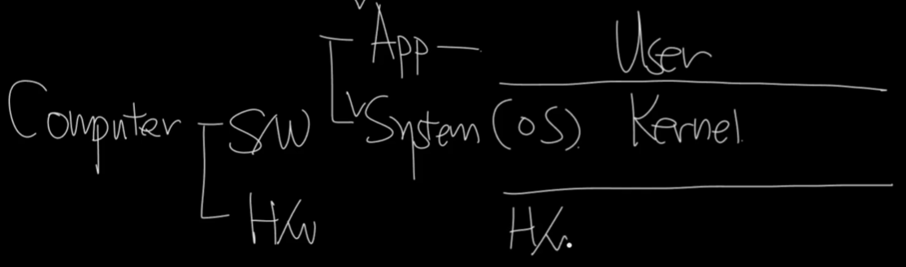

# 네트워크

# Section 01 - 들어가기에 앞서

---

- 컴퓨터는 3층집이다.
  컴퓨터는 하드웨어 1층과 소프트웨어 2층, 총 3층으로 이루어져있다.
  2층은 시스템 소프트웨어, 즉 OS이고 3층은 엑셀, 워드 같은 어플리케이션 소프트웨어이다.
  어플리케이션 소프트웨어는 유저모드로 동작하고 시스템 소프트웨어는 커널 모드로 동작한다.
  
- 요청과 응답 과정 이해
    <aside>
    💡
    
    **아주 중요한 그림입니다. 아래 그림을 계속 기억한 상태로 내용을 읽어주세요.**
    
    </aside>
    
    
    
    ## 브라우저에서 웹사이트에 접속하기까지의 과정 이해
    
    ---
    
    ## 1. 기본 구조 이해하기
    
    ### 💻 하드웨어와 소프트웨어의 관계
    
    ```
    [하드웨어]
    CPU, 메모리, NIC(네트워크 카드, LAN 카드) 등
    
    ↕ (제어)
    
    [운영체제 (OS)]
    - 드라이버: 하드웨어를 제어하는 소프트웨어
    - 네트워크 스택: 통신을 위한 프로토콜들
    - 기타 시스템 소프트웨어들
    
    ↕ (시스템 콜)
    
    [응용 프로그램]
    브라우저, 게임, 메신저 등
    ```
    
    **🔑 핵심 포인트:**
    
    - 하드웨어 위에 OS가 설치됨
    - 드라이버는 OS의 일부분으로, 하드웨어를 제어
    - 응용 프로그램은 OS 위에서 동작
    
    ---
    
    ## 2. 권한의 세계: 커널모드 vs 유저모드
    
    ### 👑 커널모드 (Kernel Mode) - "관리자 권한"
    
    - ✅ 하드웨어에 직접 접근 가능
    - ✅ 모든 메모리 영역 접근 가능
    - ✅ 시스템의 모든 기능 사용 가능
    - 📍 **OS가 여기서 동작**
    
    ### 👤 유저모드 (User Mode) - "일반 사용자 권한"
    
    - ❌ 하드웨어 직접 접근 불가
    - ❌ 제한된 메모리 영역만 접근
    - ❌ 위험한 명령어 실행 불가
    - 📍 **브라우저, 게임 등이 여기서 동작**
    
    ### 🔗 시스템 콜: 두 세계를 연결하는 다리
    
    유저모드의 프로그램이 커널모드의 서비스를 이용하는 방법
    
    **예시:**
    
    - 파일 읽기: `open()`, `read()`
    - 네트워크 통신: `socket()`, `send()`, `recv()`
    
    ---
    
    ## 3. 네트워크 통신의 7계층 (간단 버전)
    
    ### 📶 각 계층의 역할
    
    | 계층 | 이름 | 주요 프로토콜 | 역할 | 동작 위치 |
    | --- | --- | --- | --- | --- |
    | **L7** | 응용 계층 | HTTP, HTTPS | 웹페이지 요청 | 🟦 유저모드 |
    | L6, L5 | (생략) | - | - | - |
    | **L4** | 전송 계층 | TCP, UDP | 안정적인 데이터 전송 | 🟨 커널모드 |
    | **L3** | 네트워크 계층 | IP | 목적지까지 경로 찾기 | 🟨 커널모드 |
    | **L2** | 데이터링크 계층 | Ethernet | 같은 네트워크 내 통신 | 🟨 커널모드 |
    | **L1** | 물리 계층 | 전기신호, 광신호 | 실제 신호 전송 | 🟨 하드웨어/커널 |
    
    ---
    
    ### 🏷️ 계층별 데이터 상자 용어
    
    | 계층 | 이름 | 예시 |
    | --- | --- | --- |
    | **L7** | 메시지/데이터 | Ethernet 프레임 |
    | **L4** | 세그먼트 (Segment) | IP 패킷 |
    | **L3** | 패킷 (Packet) | TCP 세그먼트 |
    | **L2** | 프레임 (Frame) | HTTP 메시지 |
    
    ## 4. 실제 동작 과정: 브라우저에서 서버까지
    
    ### 📤 데이터 송신 과정 (브라우저 → 서버)
    
    ```
    🟦 [유저모드] 브라우저
    "네이버에 접속하자!"
    fetch('https://naver.com')
             ↓ 시스템 콜
    ==================== 권한의 벽 ====================
    🟨 [커널모드] 운영체제
    
    L7: HTTP 메시지 생성
    "GET / HTTP/1.1\nHost: naver.com"
             ↓
    🔒: SSL/TLS 보안 계층 (일부는 유저모드, 일부는 커널모드)
             ↓
    L4: TCP 세그먼트로 포장
    [TCP 헤더 + HTTP 메시지]
             ↓
    L3: IP 패킷으로 포장
    [IP 헤더 + TCP 세그먼트]
             ↓
    L2: Ethernet 프레임으로 포장
    [Ethernet 헤더 + IP 패킷]
             ↓
    L1: 전기신호로 변환하여 네트워크 케이블로 전송
    ```
    
    ### 📥 데이터 수신 과정 (서버 → 브라우저)
    
    ```
    🔌 네트워크에서 전기신호 수신
             ↓
    🟨 [커널모드] 운영체제가 신호를 해석
    각 헤더가 각 레이어에 도달하면 역할을 다 한 것이므로 제거한다.
    
    L2: Ethernet 헤더 제거
             ↓
    L3: IP 헤더 제거, 목적지 확인
             ↓
    L4: TCP 헤더 제거, 데이터 조립
             ↓
    L7: HTTP 응답 완성
             ↓
    🟦 [유저모드] 브라우저
    "네이버 페이지 받았다!"
    화면에 웹페이지 표시
    반환된 HTTP 응답의 Body 부분에 네이버의 HTML이 들어있다
    ```
    
    ---
    
    ## 6. 정리: 핵심 개념 요약
    
    ### 🎯 기억해야 할 5가지
    
    1. **계층 구조**: 하드웨어 → OS → 응용프로그램
    2. **권한 분리**: 커널모드(OS) vs 유저모드(앱)
    3. **시스템 콜**: 유저모드가 커널 서비스를 이용하는 방법
    4. **네트워크 스택**: L2~L4는 OS가, L7은 앱이 담당
    5. **캡슐화**: 각 계층이 자신의 헤더를 추가/제거
- OSI 7 Layer와 식별자
  cmd에서 ipconfig /all 을 해 보자. → 16진수 48비트로 이루어진 물리 계층 주소를 알 수 있다.
  
  - 내가 정리한 내용 - 이걸 지피티한테 주고 자료로 내놓으라고 했다는 사실
    각 레이어마다 고유한 식별자가 있다.
    L1에는 NIC가 있고, 여기에는 MAC 주소가 들어 있다.
    L2에서는 Frame을 수신하고 Frame에 있는 Ethernet header을 확인하여 MAC 주소를 식별한다. frame의 Ethernet 헤더에 도착지 정보가 일치하지 않으면 잘못 들어온 frame인 것이므로 frame을 버린다.
    L3에서는 Packet을 수신하고 Packet에 있는 IP Header을 확인하여 IP 주소를 식별한다. 지금 이 컴퓨터와 연결된 네트워크 IP 주소와 packet에 담긴 IP 헤더의 도착지 IP 주소가 일치하지 않으면 잘못 들어온 packet인 것이므로 Packet을 버린다.
    L4에서는 Segment를 수신하고 Segment에 있는 Segment Header을 확인하여 Port 번호를 식별한다. 컴퓨터에서 Segment Header에 담긴 port 번호가 열려 있고 여기서 요청을 수신중인 프로세스가 실행중이라면 이 Segment를 전달한다. 만약 포트는 열려 있는데 프로세스가 없으면 Segment Header의 출발지 정보 쪽으로 오류를 응답한다. 그리고 포트부터가 닫혀 있었다면 연결 자체가 안 된 것이기 때문에 Connection Refused를 응답한다.
  ## 각 계층은 자신만의 주소 체계로 데이터를 걸러낸다
  ***
  ## 🏠 전체 구조 한눈에 보기
  ```
  📱 애플리케이션 (브라우저, 게임 등)
      ↕ 포트로 구분
  🚪 L4: 전송 계층 (Port 번호)
      ↕ IP 주소로 구분
  🌐 L3: 네트워크 계층 (IP 주소)
      ↕ MAC 주소로 구분
  📡 L2: 데이터링크 계층 (MAC 주소)
      ↕ 전기신호
  🔌 L1: 물리 계층 (NIC 하드웨어)
  ```
  ***
  ## 🔍 계층별 상세 동작
  ### L1 - 물리 계층: 하드웨어의 고유 신분증
  ```
  🔌 NIC (Network Interface Card)
  ├── MAC 주소: AA:BB:CC:11:22:33
  ├── 48비트 (6바이트) 크기
  ├── 전 세계에서 유일한 주소
  └── 제조 시점에 하드웨어에 새겨짐
  ```
  **💡 실생활 비유:** 주민등록번호처럼 태어날 때부터 정해진 고유 번호
  ***
  ### L2 - 데이터링크 계층: 같은 네트워크 내 주소 확인
  ### 📦 Frame 수신 과정
  ```
  🔍 Ethernet Header 검사
  ├── 목적지 MAC = 내 MAC? → ✅ 계속 처리
  ├── 목적지 MAC = FF:FF:FF:FF:FF:FF? → ✅ 브로드캐스트, 모두 받기
  └── 다른 MAC 주소? → ❌ Frame 버림 🗑️
  ```
  ### 🎬 실제 예시
  ```
  Frame 도착: [목적지 MAC: AA:BB:CC:11:22:33][출발지 MAC: ...][데이터]

  내 MAC이 AA:BB:CC:11:22:33인 경우:
  ✅ "내 것이네!" → 상위 계층으로 전달

  내 MAC이 다른 주소인 경우:
  ❌ "내 것이 아니네..." → 조용히 버림
  ```
  **💡 실생활 비유:** 아파트 단지 우편함 - 다른 아파트 우편물은 받지 않음
  ***
  ### L3 - 네트워크 계층: 인터넷 상의 주소 확인
  ### 📮 Packet 수신 과정
  ```
  🔍 IP Header 검사
  ├── 목적지 IP = 내 IP? → ✅ 계속 처리
  ├── 라우터의 경우: 라우팅 테이블 확인 → 다른 곳으로 전달
  └── 관련 없는 IP? → ❌ Packet 버림 🗑️
  ```
  ### 🎬 실제 예시
  ```
  Packet 도착: [목적지 IP: 192.168.1.100][출발지 IP: ...][데이터]

  내 IP가 192.168.1.100인 경우:
  ✅ "내 주소로 온 패킷이네!" → 상위 계층으로 전달

  내 IP가 192.168.1.50인 경우:
  ❌ "내 주소가 아니네..." → 패킷 버림
  ```
  **💡 실생활 비유:** 집 주소 - 서울시 강남구로 온 택배를 부산에서 받지 않음
  ***
  ### L4 - 전송 계층: 컴퓨터 내 프로그램 구분
  ### 🚪 Segment 수신 과정
  ```
  🔍 TCP/UDP Header 검사
  ├── 해당 포트에서 프로세스가 대기 중? → ✅ 프로세스로 전달
  ├── 포트는 열렸지만 프로세스 없음? → ⚠️ 오류 응답
  └── 포트가 닫혀있음? → ❌ "Connection Refused"
  ```
  ### 🎬 실제 상황들
  **✅ 정상 케이스:**
  ```
  Segment 도착: [목적지 Port: 80][출발지 Port: 12345][HTTP 요청]

  포트 80에서 웹서버가 대기 중:
  ✅ "웹서버야, 요청 왔어!" → HTTP 요청 처리
  ```
  **⚠️ 프로세스 문제:**
  ```
  포트 80은 열려있지만 웹서버 프로그램이 죽은 상태:
  ⚠️ "포트는 열렸는데 처리할 프로그램이 없네?" → 오류 응답
  ```
  **❌ 포트 닫힘:**
  ```
  포트 80이 아예 닫혀있는 상태:
  ❌ "Connection Refused" → 연결 거부 응답
  ```
  **💡 실생활 비유:** 아파트 호수 - 1205호로 온 택배를 1208호에서 받지 않음
  ***
  ## 🔄 전체 필터링 과정 시뮬레이션
  ### 성공적인 웹 요청 예시
  ```
  🌐 google.com 접속 요청

  1️⃣ L2 검사: MAC 주소
     내 컴퓨터 MAC: AA:BB:CC:11:22:33
     Frame 목적지 MAC: AA:BB:CC:11:22:33
     ✅ "내 것이네!" → 다음 단계

  2️⃣ L3 검사: IP 주소
     내 컴퓨터 IP: 192.168.1.100
     Packet 목적지 IP: 192.168.1.100
     ✅ "내 IP 맞네!" → 다음 단계

  3️⃣ L4 검사: Port 번호
     Segment 목적지 Port: 443 (HTTPS)
     브라우저가 443번 포트에서 응답 대기 중
     ✅ "브라우저가 기다리고 있네!" → 브라우저로 전달

  4️⃣ 결과: 구글 웹페이지 표시! 🎉

  ```
  ### 실패하는 경우들
  ```
  ❌ L2 실패: 다른 MAC 주소
     → Frame 조용히 버림 (로그도 거의 안 남음)

  ❌ L3 실패: 다른 IP 주소
     → Packet 버림, 때로는 ICMP 오류 메시지

  ❌ L4 실패: 닫힌 포트
     → "Connection Refused" 오류 메시지
  ```
  ***
  ## 🛠️ 포트 상태의 종류
  | 상태          | 설명                    | 결과                    |
  | ------------- | ----------------------- | ----------------------- |
  | **LISTENING** | 프로세스가 연결 대기 중 | ✅ 정상 연결            |
  | **CLOSED**    | 포트가 닫혀있음         | ❌ Connection Refused   |
  | **FILTERED**  | 방화벽이 차단 중        | 🚫 응답 없음 (타임아웃) |
  ***
  ## 🔧 네트워크 문제 진단하기
  ### 단계별 확인법
  ```
  🔍 문제 진단 순서

  1️⃣ 물리적 연결: 케이블, WiFi 연결 확인
  2️⃣ L2 확인: 같은 네트워크에 있는지 확인
  3️⃣ L3 확인: IP 주소, 라우팅 확인 (ping 명령어)
  4️⃣ L4 확인: 포트 상태 확인 (telnet, netstat 명령어)
  ```
  ### 자주 보는 오류 메시지들
  - **"Connection Failed"** → L2 또는 L3 문제
  - **"Connection Refused"** → L4 문제 (포트 닫힘)
  - **"Connection Time out"** → 방화벽 또는 서버 다운
  ***
  ## 💡 핵심 정리
  ### 🎯 기억해야 할 5가지
  1. **각 계층마다 고유한 주소 체계**가 있다
  2. **상위 계층으로 갈수록 더 구체적**으로 식별한다
  3. **어느 단계에서든 맞지 않으면 버린다**
  4. **오류 응답은 주로 L4에서 발생**한다
  5. **문제 해결은 하위 계층부터** 확인한다
  ### 🏠 층별 비유 정리
  - **L1**: 건물 (하드웨어)
  - **L2**: 아파트 단지 (로컬 네트워크)
  - **L3**: 집 주소 (인터넷 주소)
  - **L4**: 호수 (프로그램별 구분)
  **🎉 이제 "왜 연결이 안 되는지" 단계별로 분석할 수 있습니다!**
