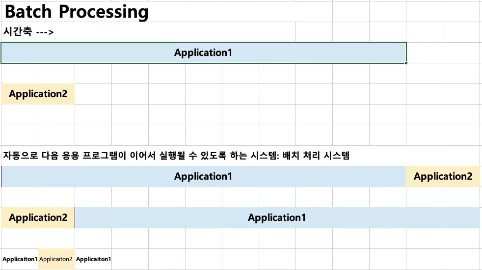

# 프로세스 스케줄링

# 스케줄링 알고리즘

---

## 배치 처리 시스템

---

처음 스케줄링의 개념이 없었던 때에는, 하나의 프로세스가 실행되는 동안 다른 프로세스는 실행될 수 없었고, 다음 프로세스를 실행하기 위해서는 앞 프로세스가 종료되기를 기다렸다가 새로 실행해야 했었다.

<aside>
💡

한 프로그램이 끝나면 다음 프로그램이 연달아서 실행되도록 할 수는 없을까?

</aside>

위와 같은 고민을 해결하기 위해 ‘**배치 처리 시스템’**이라는 운영 체제의 스케줄링 기능이 등장

Application2를 Application1의 뒤에 이어붙여서 자동으로 다음 프로그램이 실행될 수 있도록 하는 방식

따라서 실행시키고 싶은 프로그램을 등록만 해 두면 운영체제가 모두 순서대로 실행을 시켜줄 수 있게 된 것

구조를 보면 바로 이해할 수 있듯이, **Queue** 자료 구조로 구현되어 FIFO 특성을 갖는다.

## 배치 처리 시스템 한계 - 멀티 프로그래밍 등장

---

### 배치 처리 시스템의 한계

한 번에 하나의 작업만 메모리에 적재해서 실행 → CPU는 작업이 끝날 때까지 기다려야 했다.

입출력(I/O) 작업이 많으면 CPU는 놀고 있게 되어 **자원 활용률이 낮음.**

<aside>
💡

CPU를 최대한 쉬지 않도록 효율적으로 활용할 수 있는 방법이 없을까?

</aside>

위 고민에 대한 해법으로, 멀티 프로그래밍 스케줄링이 등장

### 멀티 프로그래밍

최대한 CPU를 많이 활용하도록 하는 시스템

멀티 프로그래밍을 이해하기 위해서는 하드웨어 관점에서 메모리 계층을 이해할 필요가 있다.

아래 그림에서 On chip까지는 CPU에 있는 저장 공간이고 그 아래는 메인 보드에 있는 저장 공간이다.

**Register** : CPU 안에 있어서 CPU가 연산할 때 즉시 접근이 가능한 가장 빠른 공간. 명령어 하나를 실행하는 시간을 1 cycle이라고 한다.

**Level Cache** : CPU를 chip이라고도 부르고, chip 안에 연산을 하는 core가 보통 여러 개 있다.(옛날에는 1개) L1 Cache와 L2 Cache는 Core 각각이 개별로 갖고 있는 Cache고 L3 Cache는 CPU내 Core들이 공유하는 Cache 다.

**Main Memory** : 우리가 Ram, DRam이라고 부르는 것. 인간의 뇌에서 작업 기억, 단기 기억으로 많이 비유되고 프로그램을 실행하기 위해 필요한 데이터들이 디스크 또는 드라이브에서 이 위치로 로드되는데 이를 운영 체제가 ‘자원을 할당한다’라고 표현한다.

**Flash Drive** : SSD 저장 장치, 장기기억, 그런데 HDD에 비해 많이 빠르지만 정말 어쩌다 한 번씩 데이터가 유실될 수도 있는 저장 장치 (us = micro seconds, 1ms = 100us)

**Hard Disk** : HDD 저장 장치, 장기 기억, SSD에 비해 느리지만 매우 견고하고 데이터 유실 위험이 거의 없는 저장 장치

위와 같은 메모리 구조를 고려했을 때, 어떤 프로세스가 Main Memory나 Flash Drive에 있는 데이터를 조회해 와야 하는 작업을 수행해야 한다고 해 보자. Main Memory의 경우 cpu가 연산을 200번 할 수 있는 시간 동안 놀고 있게 된다. 이러한 비효율을 제거하고 싶었기 때문에 멀티 프로그래밍이 등장하게 된 것.

따라서 아래 그림의 첫 상황과 같은 상황을, 두 번째, 세 번째 상황으로 만들어 cpu의 성능을 최대한 활용하는 방식으로 프로세스를 스케줄링하는 것이 멀티 프로그래밍이다.

## 멀티 프로그래밍 이후 - 시분할 시스템과 멀티 태스킹

---

멀티 프로그래밍은 그림에서 0.1초로 모두 동일하게 프로세스를 분리한 것으로 보이지만 실제로는 모두 동일하지는 않았고, 기본적으로 프로세스 하나가 돌아가는 동안 발생하는 비효율, 이 시간 동안에만 다른 프로세스가 실행되기 때문에 만약 cpu 레벨의 저장 공간만을 지속적으로 활용하는 프로세스라면 거의 배치 처리 시스템과 동일하게 동작하게 된다.

따라서 배치 처리 시스템의 문제점을 온전히 해결하는 스케줄링은 아니었고 이후 시분할 시스템과 멀티 태스킹이 등장하게 된다.

### 시분할 시스템

배치처리 시스템의 문제 : 한 번에 하나의 프로그램만 실행될 수 있다.

→ 옛날에는 컴퓨터 한대에 여러 사용자가 접속해 컴퓨터를 사용했었는데, 한 대의 컴퓨터가 하나의 프로그램만 실행할 수 있으므로 다른 사람들은 먼저 실행된 프로그램이 있으면 내 프로그램이 실행되길 기다려야 했다.

<aside>
💡

컴퓨터를 여러 사용자가 동시에 사용할 수 있도록 할 수는 없을까?

</aside>

위와 같은 한계를 극복하기 위해, 시분할 시스템이 등장

**시분할 시스템 :** 다중 사용자 지원을 위해 컴퓨터 응답 시간을 최소화하는 시스템

배치 처리 시스템이 모든 프로세스를 하나씩 순서대로 실행시켰다면, 시분할 시스템은 프로세스를 100ms단위로 쪼개서 프로세스마다 한 번 실행될 때 100ms동안만 cpu를 점유할 수 있도록 하여 프로세스들을 매우 빠르게 교차 실행시키는 방식으로 여러 사용자들의 프로그램 실행 후 기약 없이 기다리기만 해야 하는 상황을 해결했다.

멀티 프로그래밍이 cpu 비효율이 발생하는 구간에만 다른 프로세스의 작업을 실행하는 것과 달리, 시분할 시스템은 시간 단위로 반드시 프로세스들을 교차 실행하므로 사용자 응답 시간의 저점을 크게 개선할 수 있었다.

---

### 멀티 태스킹

배치처리 시스템의 문제 : 한 번에 하나의 프로그램만 실행될 수 있다.

→ 문제 의식은 시분할 시스템의 등장 배경과 동일하지만, 관점이 다중 사용자가 아니라 한 사용자가 여러 프로그램을 실행하고자 하는 과정에서 등장

<aside>
💡

컴퓨터 하나에서 여러 응용 프로그램을 동시에 실행할 수는 없을까?

</aside>

쉽게 말해서, 음악을 들으면서 문서 작업도 하고 싶었던 것.

시분할 시스템과 동일하게, 프로그램1을 일부 실행했다가 프로그램2를 일부 실행하는 방식.

→ 프로그램이 매우 빠르게 교차 실행되기 떄문에 동시에 실행되는 ‘것처럼’ 보이는 것. 하드 웨어 관점에서 CPU가 멀티 코어가 있어서 실제로 여러 프로그램이 동시에 실행되는 것과는 다르다.

목적과 이름이 다르지만 구현 방식은 동일하다.

시분할 시스템을 최초로 지원하면서 등장한 운영체제가 바로 UNIX이고, 이 UNIX와 유사한 형태와 기능을 가지면서 무료인 운영체제가 바로 **Linux**이다.

그리고 멀티 태스킹을 최초로 지원하면서 컴퓨터로 음악을 들으면서 문서 작업을 할 수 있는 운영체제라는 내용으로 인기를 끌었던 운영체제가 **Windows**이다.

- 참고 - 멀티 태스킹 VS 멀티 프로세싱
    
    멀티 태스킹: cpu 하나에 여러 프로세스들이 교차 실행되는 것
    
    멀티 프로세싱 : 하나의 프로세스의 작업을 분리하고, 이 분리한 작업을 여러 cpu(정확히는 여러 core)에서 나눠 가져가서 실행하는 것. → 작업 속도가 core의 개수만큼 배가 된다.
    
    
    

# 스케줄러

---

스케줄러의 종류는 매우 다양하고, 각 스케줄러마다 특징, 강점, 약점이 존재한다. 그리고 현대의 운영 체제는 하나의 스케줄러만을 채택하는 것이 아니라 여러 스케줄러를 상황과 각각의 강점에 맞게 혼용하고 있다.

## FIFO 스케줄러

> 프로세스를 시작부터 종료까지 CPU를 계속 점유하도록 하는 스케줄러
> 

가장 간단한 스케줄러로, 배치 처리 시스템을 적용할 때 활용되는 스케줄러

Ready Queue에 프로세스를 순서대로 push하고, 순서대로 pop해서 프로세서에 전달

## 최단 작업 우선 (SJF) 스케줄러

> SJF(Shortest Job First) 스케줄러, 가장 실행 시간이 짧은 프로세스부터 먼저 실행시킨다.
> 

어떤 프로세스가 얼마나 걸릴지 보통 모르기 때문에, 매우 특수하게 이를 알고 있는 상황이라면 우선순위 큐와 힙 자료구조를 이용해 효율적으로 스케줄링을 수행할 수 있다.

## 우선순위 기반 스케줄러

> 프로세스마다 우선 순위를 부여하여 해당 순위를 기준으로 스케줄링을 수행하는 스케줄러
> 
- 정적 우선 순위 : 프로세스마다 우선 순위를 미리 정해 놓고 스케줄링하는 방식
- 동적 우선 순위 : 스케줄러가 상황에 따라 우선순위를 동적으로 변경하여 스케줄링하는 방식

## Round Robin 스케줄러

> 프로세스를 Ready Queue에 순서대로 넣고, 프로세서가 이를 처리하되 일정 시간 이상 완료되지 않으면 Ready Queue로 다시 보내 프로세스의 실행을 순환시키는 스케줄러
> 
- 시분할 시스템 스케줄링에 활용되는 스케줄러

## 프로세스 상태 기반 스케줄러

> FIFO, Round Robin과 함께 현대 스케줄링 알고리즘의 기본이 되는 스케줄러
> 

멀티 프로그래밍과 멀티 태스킹에 활용되는 스케줄러

- running state : 현재 CPU에서 실행 중인 상태
- ready state : CPU에서 실행 가능한 상태 (실행 대기 상태)
- block state : 특정 이벤트 발생 대기 상태

위 사진과 설명만으로는 조금 이해가 어려우니, 예시를 들어 이해해 보자

<aside>
💡

**참고** : 각 스케줄러가 어떤 알고리즘에 활용되는지 위에 작성은 했지만, 처음에도 말했듯이 여러 스케줄러가 각각의 상황에 맞게 다양하게 활용되고 있기 때문에 정확히 대응되는 것은 아니다.

</aside>